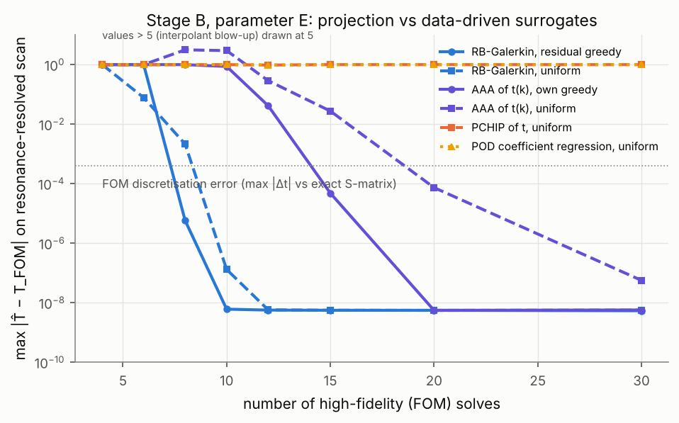
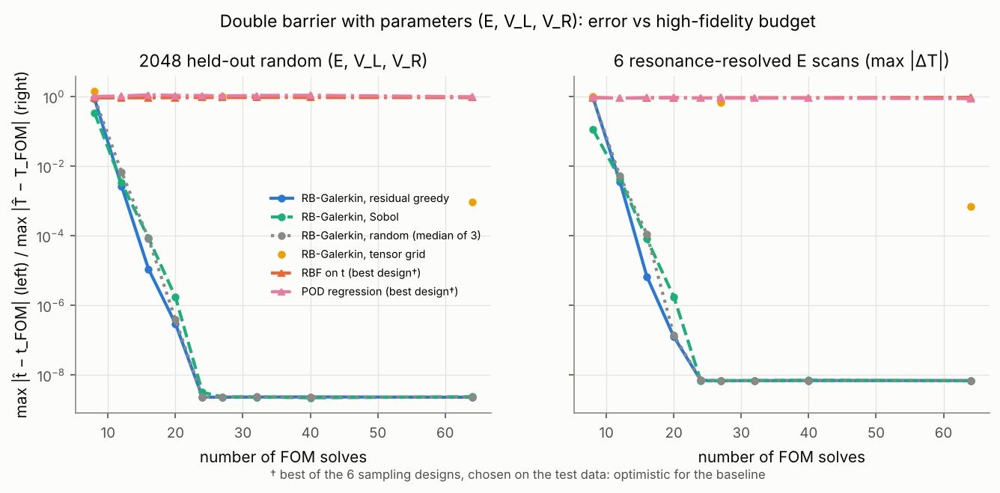
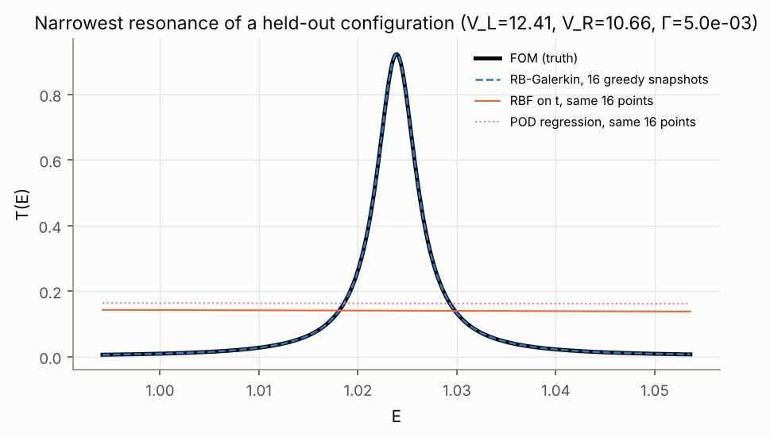
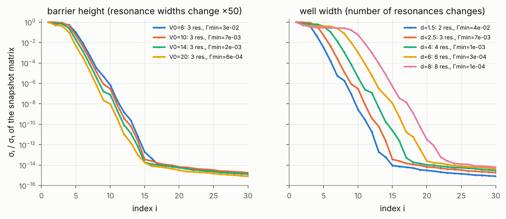

# Применение суррогатных моделей для ускорения параметрических расчётов в задаче квантового рассеяния

**Курсовая работа по вычислительной физике (3 курс)**

**Автор:** Ростислав Першин (Rostislav Pershin), студент бакалавриата, направление «вычислительная физика».

Все числа, таблицы и рисунки в этом тексте получены скриптами из каталога `scripts/` данного репозитория;
исходные результаты хранятся в `results/`. Команды для воспроизведения приведены в `README.md`.

---

## Аннотация

Исследуется, как сократить число дорогостоящих точных расчётов, необходимых для восстановления
энергетической (и параметрической) зависимости наблюдаемых одномерного квантового рассеяния —
комплексной амплитуды прохождения t(E) и вероятности прохождения T(E) = |t(E)|². Эталонный решатель
основан на композиции матриц рассеяния слоёв (звёздное произведение Редхеффера) и проверен
аналитической формулой (отклонение 4·10⁻¹⁵), законом сохранения вероятности (7·10⁻¹⁴) и независимым
интегрированием ОДУ (≤ 3·10⁻¹⁰). Сравниваются кусочно-полиномиальная интерполяция (линейная, PCHIP,
кубический сплайн), гауссовские процессы, рациональная аппроксимация AAA, малые нейронные сети
PyTorch (MLP, в том числе с фурье-признаками) и стратегии последовательного (адаптивного) выбора точек.

Основные результаты:

1. Для гладкой зависимости T(E) (одиночный барьер) достаточно ~10 точных вычислений; классические
   методы точнее нейросети на 2–10 порядков при равном числе вычислений.
2. Для резонансного туннелирования (двойной барьер) все «локальные» методы на равномерной сетке
   ограничены тем, *где* взяты точки: узкий резонанс (Γ = 7,5·10⁻³) не воспроизводится даже по 640
   точкам, ошибка остаётся ≈ 2·10⁻².
3. **Рациональная аппроксимация комплексной амплитуды t(k)** (k = √E) — физически мотивированная
   тем, что резонансы являются полюсами t(k), — восстанавливает все резонансы по 15–30 равномерно
   расположенным точкам во всех 38 системах эксперимента 3 (ширины резонансов от 2,5·10⁻² до
   5·10⁻⁷); в независимом стресс-тесте (27 систем) — по 20–40 точкам, а при многих полюсах в окне
   (интервал до E = 60) — по 80. Это на 1–3 порядка меньше, чем требуется остальным исследованным
   методам. AAA — известный алгоритм; вклад работы — систематическая проверка его применения к
   амплитуде рассеяния и сравнение с другими суррогатами. Жадный рациональный алгоритм с упреждающей оценкой ошибки сам сертифицирует
   сходимость в 65 из 65 систем: в 64 истинная ошибка в момент остановки была на уровне машинной
   точности или шума данных, в одной (шум 10⁻⁴) — в 45 раз выше уровня шума (раздел 10.7).
4. Адаптивный выбор точек по комплексной амплитуде (а не по T) действительно помогает локальным
   интерполянтам, однако эффект зависит от фазового соглашения и параметров системы; это
   эмпирическое наблюдение, а не общая гарантия.
5. Узкий резонанс обнаружим по равномерной выборке с шагом h, только если его «сигнал в хвостах»
   Γ/h заметно превышает наибольшую из ошибки данных и ошибки аппроксимации фона (построена
   экспериментальная карта обнаружимости; коэффициент не универсален).
6. В параметрической задаче (E, V₀, a, d) → t (40 отложенных конфигураций, 20 вне области обучения)
   нейросеть MLP превосходит все универсальные интерполяторы (тензорный сплайн, RBF, ГП, POD+MLP) — в
   отличие от одномерного случая; фурье-признаки и диссипативное предобучение при равном бюджете её
   не улучшили. Физически структурированная гибридная модель (выученная S-матрица одиночного барьера +
   точная композиция) точнее MLP на 2–3 порядка (RMSE 4,5·10⁻⁵ при 2 048 вычислениях). AAA, применённая
   отдельно к каждой новой конфигурации, требует лишь 16 вычислений на конфигурацию (RMSE 6·10⁻¹⁰).
7. Независимый стресс-тест на 27 ранее не использованных системах (асимметричные барьеры, дублеты
   резонансов, гладкий потенциал, широкие интервалы, шум) подтвердил выводы о рациональной
   аппроксимации и выявил её пределы: неустойчивость при недостаточном числе точек, преждевременную
   самосертификацию при шумных данных.
8. Экономия вызовов решателя превращается в экономию времени только для дорогого решателя: с
   ОДУ-решателем (4,4 мс на вызов) построение кривой T(E) по 30 точкам + AAA в 670–700 раз быстрее
   прямого расчёта на 20 001 точке (два независимых измерения), с быстрым матричным решателем
   выигрыша нет.
9. **Проекционная модель приведённого базиса** (метод Галёркина на снимках волновых функций,
   раздел 10.11) использует само уравнение Шрёдингера, а не только значения t. В задаче Stage B она
   достигает предела округления эталона (max |ΔT| ≈ 6·10⁻⁹) за 10 точных решений, тогда как AAA с
   собственным жадным отбором нужно 20. В трёхмерной задаче (E, V_L, V_R) ей достаточно 24 решений,
   а интерполяция t и регрессия POD-коэффициентов при тех же 64 решениях дают ошибку порядка 1.
   В исследованном семействе потенциалов размер базиса почти не менялся при сужении резонансов в
   50 раз и рос вместе с числом резонансов (и длиной ямы). Метод интрузивен: нужны оператор и
   волновые функции. SPEEDCLAIM

### Основные обозначения

| символ | смысл |
|---|---|
| ħ, m | постоянная Планка, масса частицы; используются единицы ħ²/2m = 1 |
| x | координата (одномерная задача); r, θ — радиус и угол рассеяния (трёхмерная задача) |
| V(x), V_j | потенциал; его значение в слое j |
| V₀, a, d | высота барьера, ширина барьера, ширина ямы двойного барьера |
| E, k = √E | энергия налетающей частицы и асимптотическое волновое число |
| q_j = √(E − V_j), κ = √(V − E) | волновое число в слое j; декремент затухания под барьером |
| ψ(x) | стационарная волновая функция |
| t(E), r(E) | комплексные амплитуды прохождения и отражения (глобальное соглашение, раздел 2.2) |
| T = \|t\|², R = \|r\|² | вероятности прохождения и отражения |
| S | матрица рассеяния (2×2 в одномерной задаче) |
| M_j | матрица переноса (ψ, ψ') через слой j |
| E_n, Γ_n | энергия и ширина n-го резонанса; E_p = E_r − iΓ_p/2 — полюс амплитуды |
| FWHM | ширина пика T(E) на полувысоте (не тождественна Γ_p, раздел 10.9) |
| f(θ), δ_ℓ, σ | трёхмерная амплитуда рассеяния, фазы парциальных волн, сечение (только в разделе 2.5) |
| N | число точных вычислений (вызовов решателя) — мера стоимости |
| h | шаг выборки по энергии |
| RMSE(T) | среднеквадратичная ошибка T̂ − T на эталонной сетке |
| σ (в контексте данных) | относительный уровень шума выходных данных решателя |

---

## 1. Введение

### 1.1 Мотивация

Во многих задачах физики рассеяния наблюдаемые нужно знать на плотной сетке энергий и при многих
значениях параметров системы: при подгонке параметров потенциала к эксперименту, при оценке
неопределённостей, при расчётах сечений для переноса излучения или моделирования реакций. Каждое
значение требует решения уравнения Шрёдингера (или Липпмана–Швингера) — «высокоточного» (high-fidelity)
расчёта. Если такой расчёт дорог, естественно заменить его **суррогатной моделью**: дешёвой
аппроксимацией, построенной по небольшому числу точных расчётов.

Трудность состоит в **резонансах**: узкие пики в энергетической зависимости занимают малую долю
интервала, но несут основную физическую информацию (квазистационарные состояния, их энергии и времена
жизни). Метод, хорошо работающий для гладких кривых, может полностью «пропустить» узкий резонанс.

### 1.2 Цель и вопросы исследования

**Объект исследования** — одномерное квантовое рассеяние на потенциалах конечного радиуса действия
(прямоугольные одиночные, двойные и тройные барьеры, гладкий двойной гауссов барьер).
**Предмет** — методы построения суррогатных моделей энергетической и параметрической зависимости
амплитуды прохождения по ограниченному числу точных расчётов.

**Цель** — экспериментально установить, какими способами можно надёжно (с сохранением узких
резонансов) сократить число точных расчётов амплитуды t(E) и вероятности T(E), и **когда машинное
обучение даёт преимущество** перед классическими численными методами. Мы не предполагаем заранее,
что нейросети лучше; это проверяется экспериментально.

**Задачи:** (1) реализовать и независимо проверить эталонный решатель; (2) сравнить при равном числе
точных вычислений интерполяцию, гауссовские процессы, рациональную аппроксимацию и нейросети PyTorch
для гладких и резонансных зависимостей; (3) исследовать адаптивный выбор точек; (4) проверить
устойчивость выводов на системах, не использованных при разработке; (5) исследовать параметрическую
задачу (E, V₀, a, d) → t; (6) измерить реальные вычислительные затраты.

| № | Вопрос | Раздел |
|---|---|---|
| В1 | Сколько точных вычислений нужно для гладкой наблюдаемой? | 9 |
| В2 | Как ошибка зависит от числа вычислений N? | 9, 10 |
| В3 | Может ли нейросеть PyTorch выучить комплексную амплитуду t(E)? | 9.3, 10.2 |
| В4 | Превосходит ли МО классическую интерполяцию? | 9, 10, 13 |
| В5 | Помогает ли последовательный выбор точек? | 8, 10.3 |
| В6 | Сокращает ли адаптивная выборка число вычислений для резонансов? | 10.3–10.4 |
| В7 | Когда суррогаты полезны, а когда достаточно классических методов? | 11, 13 |

### 1.3 Что сделано

* Реализован и всесторонне проверен решатель для одномерных кусочно-постоянных потенциалов (раздел 4).
* Проведены эксперименты: (1) эффективность по числу вычислений, 984 запуска; (2) адаптивная выборка,
  544 запуска; (3) устойчивость выводов на 38 системах, 8 360 запусков; (3б) карта обнаружимости
  узкого резонанса; (4) параметрический суррогат (E, V₀, a, d) → t, 51 обучение × 60 конфигураций;
  (5) независимый стресс-тест на 27 ранее не использованных системах, 660 запусков; а также
  независимый аудит результатов (`results/audit/audit_report.md`) и измерение вычислительных затрат
  (`results/cost/cost_1d.md`).
* Эксперимент 6 (раздел 10.11): проекционная модель приведённого базиса с жадным отбором по невязке
  на конечно-элементном эталоне. Проведено сравнение с AAA, PCHIP, RBF и регрессией POD-коэффициентов
  при равном числе точных решений, в задачах по E и по (E, V_L, V_R). Запланированная проверка на
  внешних данных (сечения CO2–He в приближениях CC и CSA) не выполнена: данные недоступны
  (`docs/PHASE6_DATA_AUDIT.md`).

---

## 2. Постановка задачи квантового рассеяния

### 2.1 Стационарное уравнение Шрёдингера

Частица массы m с энергией E > 0 рассеивается на одномерном потенциале V(x), отличном от нуля
лишь на отрезке [x_L, x_R] (потенциал конечного радиуса действия). Стационарное уравнение Шрёдингера

  −(ħ²/2m) ψ''(x) + V(x) ψ(x) = E ψ(x)

в безразмерных единицах ħ²/2m = 1 принимает вид

  −ψ''(x) + V(x) ψ(x) = E ψ(x),  k = √E,

где k — асимптотическое волновое число. Единица длины произвольна; энергия измеряется в единицах
ħ²/(2m·[длина]²).

### 2.2 Асимптотические условия и амплитуды рассеяния

Вне области действия потенциала решения — плоские волны e^{±ikx}. При стандартной временной
зависимости Ψ(x, t) = ψ(x) e^{−iEt/ħ} волна e^{ikx} распространяется вправо, e^{−ikx} — влево (фазовая
и групповая скорости ħk/m > 0 для e^{ikx}). Задача рассеяния ставится так:
волна единичной амплитуды падает слева; справа есть только уходящая волна:

  ψ(x) = e^{ikx} + r(E) e^{−ikx},  x < x_L;
  ψ(x) = t(E) e^{ikx},       x > x_R.

Здесь t(E) — **комплексная амплитуда прохождения**, r(E) — **амплитуда отражения**. Обе определены в
**единой (глобальной) системе координат** x; соглашение зафиксировано в коде (`smatrix.py`) и
проверено тестом: глобальная t не зависит от сдвига потенциала как целого.

Физический смысл: |t|² и |r|² — доли потока частиц, прошедших и отражённых. Плотность потока
j = (ħ/m) Im(ψ* ψ'); для падающей волны j_inc = ħk/m, прошедшей — |t|² ħk/m, отражённой — |r|² ħk/m. Отсюда

  T(E) = |t(E)|²,  R(E) = |r(E)|²,

и для вещественного (непоглощающего) потенциала из сохранения потока следует **T + R = 1**.
Аргумент arg t(E) — фаза прохождения; её производная по энергии связана с временем задержки
(время Вигнера). Для поглощающего потенциала (Im V < 0) T + R < 1, разность — вероятность поглощения.

**Матрица рассеяния одномерной задачи.** Если допустить падение и слева, и справа, асимптотики
связывают амплитуды уходящих волн с амплитудами падающих матрицей 2×2

  S = [[r, t'], [t, r']],

где r', t' — амплитуды отражения и прохождения при падении справа. Сохранение потока для
вещественного V означает **унитарность** S†S = 1, откуда |r|² + |t|² = 1, |r'|² + |t'|² = 1 и
r̄t' + t̄r' = 0 (черта — комплексное сопряжение); инвариантность относительно обращения времени
даёт t = t' (в глобальном соглашении). Все три соотношения проверены численно для асимметричных
структур: |t − t'| ≤ 2·10⁻¹⁶, |r̄t' + t̄r'| ≤ 4·10⁻¹⁵, ||r'|² + |t'|² − 1| ≤ 2·10⁻¹⁴.
Резонансы — полюсы S (общие полюсы t, r, r') в нижней полуплоскости комплексного k.

### 2.3 Одномерное прохождение и трёхмерное сечение — разные величины

Вероятность прохождения T(E) **не является сечением рассеяния**. T безразмерна, лежит в [0, 1] и не
имеет угловой зависимости. Сечение σ(E) имеет размерность площади и определяется амплитудой рассеяния
f(θ) трёхмерной задачи; для центрального потенциала в разложении по парциальным волнам

  f(θ) = (1/k) Σ_ℓ (2ℓ+1) e^{iδ_ℓ} sin δ_ℓ P_ℓ(cos θ),  σ(E) = (4π/k²) Σ_ℓ (2ℓ+1) sin² δ_ℓ(E),

где фазы δ_ℓ находятся из радиального уравнения u_ℓ'' + [k² − V(r) − ℓ(ℓ+1)/r²] u_ℓ = 0 с условием
u_ℓ(0) = 0. **В работе T(E) нигде не называется сечением.**

Сопоставление величин:

| величина | задача | смысл | размерность |
|---|---|---|---|
| t(E) | 1D | комплексная амплитуда прошедшей волны (модуль и фаза) | безразмерна |
| T(E) = \|t\|² | 1D | вероятность прохождения (доля потока) | безразмерна, ∈ [0, 1] |
| f(E, θ) | 3D | амплитуда расходящейся сферической волны ψ ~ e^{ikz} + f(θ) e^{ikr}/r | длина |
| dσ/dΩ = \|f(E, θ)\|² | 3D | дифференциальное сечение | площадь / ср |
| σ(E) = ∫\|f\|² dΩ = (4π/k) Im f(E, 0) | 3D | полное (упругое) сечение; второе равенство — оптическая теорема | площадь |
| E_r, Γ | 1D и 3D | энергия и ширина резонанса; определяются полюсом S-матрицы E_r − iΓ/2 | энергия |

### 2.4 Почему одномерная модель — подходящая начальная модель

1. **Точная проверяемость.** Для кусочно-постоянных потенциалов t(E) вычисляется с машинной
   точностью, есть аналитическая формула для одиночного барьера и независимый ОДУ-решатель; поэтому
   ошибки суррогатов отделяются от ошибок эталона (эталон точнее на 10 порядков).
2. **Та же аналитическая структура.** Резонансы — полюсы S-матрицы в нижней полуплоскости k, как и
   формные резонансы в парциальных волнах трёхмерной задачи; именно эта структура определяет главные
   выводы работы.
3. **Самостоятельная физика.** Резонансное туннелирование через двойной барьер описывает реальные
   устройства (резонансно-туннельные диоды, Tsu, Esaki, 1973).
4. **Дешевизна.** Плотные эталонные сетки (до 10⁵ точек) и десятки тысяч экспериментов возможны на
   одном CPU, что необходимо для статистически осмысленного сравнения методов.

### 2.5 Что изменится в трёхмерной задаче

* **Граничное условие:** вместо прохождения/отражения — падающая плоская и расходящаяся сферическая
  волна ψ ≈ e^{ikz} + f(θ) e^{ikr}/r; наблюдаемые — dσ/dΩ и σ, а не T.
* **Уравнения:** для центрального потенциала — набор радиальных уравнений
  u_ℓ'' + [k² − V(r) − ℓ(ℓ+1)/r²] u_ℓ = 0 с u_ℓ(0) = 0; фазы δ_ℓ извлекаются сшивкой с функциями
  Риккати–Бесселя; S_ℓ = e^{2iδ_ℓ}, |S_ℓ| = 1. Центробежный барьер сам создаёт формные резонансы.
* **Резонанс в парциальной волне ℓ** описывается формулой Брейта–Вигнера
  σ_ℓ(E) = (4π/k²)(2ℓ+1) (Γ/2)²/[(E − E_r)² + (Γ/2)²] с унитарным пределом (4π/k²)(2ℓ+1).
* **Суррогаты** следует строить для парциальных амплитуд (S_ℓ − 1)/(2i) = e^{iδ_ℓ} sin δ_ℓ —
  мероморфных функций k, — а сечения вычислять из них; число ℓ, дающих вклад, растёт с k·R.
* **Новые трудности:** нецентральные потенциалы (связанные каналы, матричная S), кулоновское
  взаимодействие (модифицированная асимптотика и кулоновские фазы; аналитическая структура иная),
  неупругость (|S_ℓ| < 1), спин. Выводы данной работы на эти случаи без проверки не переносятся.
* Расширение не меняет решаемую в работе задачу: оно описано как перспектива (раздел 12.4).

---

## 3. Математическая модель и граничные условия

### 3.1 Кусочно-постоянный потенциал

V(x) = V_j при x ∈ [x_j, x_{j+1}), j = 0…n−1, и V = 0 вне [x_0, x_n]. Используются:

* **одиночный прямоугольный барьер** высоты V₀ и ширины a (этап A);
* **симметричный двойной барьер**: два барьера высоты V₀ и ширины a, разделённые ямой ширины d
  (этап B); центр потенциала совмещён с x = 0.

### 3.2 Условия сшивки

Уравнение второго порядка с ограниченным V требует непрерывности ψ и ψ' на границах слоёв. Внутри
слоя j общее решение ψ = A e^{iqx} + B e^{−iqx}, q² = E − V_j. При E < V_j волновое число мнимое,
q = iκ, κ = √(V_j − E): решение — комбинация растущей и затухающей экспонент (подбарьерная, или
эванесцентная, область).

### 3.3 Аналитическое решение для одиночного барьера (проверочное)

Для барьера V₀ ширины a:

  T = [1 + V₀² sh²(κa) / (4E(V₀ − E))]⁻¹, E < V₀;
  T = [1 + V₀ a²/4]⁻¹,           E = V₀;
  T = [1 + V₀² sin²(qa) / (4E(E − V₀))]⁻¹, E > V₀,

и комплексная амплитуда t = e^{−ika} / [cos qa − i (k² + q²)/(2kq) sin qa]. Над барьером T = 1 при
qa = nπ (резонансы прохождения над барьером).

### 3.4 Резонансное туннелирование и полюса амплитуды

В двойном барьере яма между барьерами поддерживает **квазистационарные уровни** E_n. При E ≈ E_n
волна многократно отражается между барьерами, амплитуды складываются в фазе, и для симметричной
структуры T(E_n) = 1, хотя каждый барьер в отдельности почти непрозрачен. Вблизи изолированного
резонанса справедлива формула Брейта–Вигнера

  t(E) ≈ t_фон(E) + c · (Γ/2) / (E − E_n + iΓ/2),  T(E) ≈ (Γ/2)² / [(E − E_n)² + (Γ/2)²],

где c — комплексная константа (|c| ≈ 1 для симметричной структуры, где T(E_n) = 1), а вторая формула
для T написана в пренебрежении фоном. Γ — ширина резонанса, ħ/Γ — время жизни квазисвязанного
состояния. **Строго Γ определяется полюсом:** аналитическое продолжение t(E) имеет полюс в точке
E = E_n − iΓ/2. Этот полюс лежит не на физическом листе римановой поверхности t(E) (физическому
листу соответствует Im k > 0, там возможны лишь полюсы связанных состояний), а на втором,
нефизическом листе, т. е. в нижней полуплоскости комплексного k: k_n = k_r − iγ. С шириной пика T(E)
на полувысоте (FWHM) полюсная ширина совпадает только для изолированного резонанса с малым фоном;
отличия измерены в разделе 10.9. Мероморфность амплитуды как функции k объясняет главный результат
работы (раздел 10.4).

---

## 4. Численные методы расчёта амплитуд рассеяния

### 4.1 Пропагатор слоя

Для слоя j толщины d связь (ψ, ψ') на его границах задаётся матрицей

  M_j = [[cos qd, sin(qd)/q], [−q sin qd, cos qd]],  det M_j = 1.

Все элементы — **целые функции q²**: cos qd = Σ(−q²d²)ⁿ/(2n)!, sin(qd)/q = d·Σ(−q²d²)ⁿ/(2n+1)!. Поэтому
(i) не нужно выбирать ветвь √(E − V); (ii) случай E < V не требует отдельной формулы; (iii) точка
поворота E = V регулярна (в базисе e^{±iqx} она вырождена). В коде sin(qd)/q вычисляется как
d·sinc(qd/π).

### 4.2 Матрица рассеяния слоя

Пусть слой окружён средой с волновым числом k. Подставляя слева (1 + r, ik(1 − r)), справа (t, ik t)
и используя det M = 1, получаем

  α = ik m₁₁ − m₂₁, β = −k² m₁₂ − ik m₂₂, r = −(α + β)/(α − β), t = 2ik/(α − β),

т. е. для однородного слоя t = 2ik / (2ik cos qd + q sin qd + k² sin(qd)/q). Однородный слой зеркально
симметричен, поэтому r' = r, t' = t.

### 4.3 Композиция: звёздное произведение Редхеффера

Матрицы рассеяния соседних слоёв A и B объединяются по формулам

  t = t_B (1 − r'_A r_B)⁻¹ t_A,   r = r_A + t'_A r_B (1 − r'_A r_B)⁻¹ t_A,
  t' = t'_A (1 − r_B r'_A)⁻¹ t'_B,  r' = r'_B + t_B r'_A (1 − r_B r'_A)⁻¹ t'_B.

Множитель (1 − r'_A r_B)⁻¹ = Σ(r'_A r_B)ⁿ — сумма многократных отражений между A и B; при резонансе
именно он становится большим.

**Устойчивость.** Перемножение матриц переноса M по многим слоям перемножает растущие множители
e^{κd} разных барьеров, и их отношения теряют точность. В звёздном произведении участвуют только
ограниченные величины (|S_ij| ≤ 1 при вещественном V); большие величины ch κd возникают лишь внутри
одного слоя и только в отношениях. Решатель отказывает с сообщением об ошибке при κd > 600 (до
переполнения double); барьер с κd ≈ 400 обрабатывается корректно.

### 4.4 Переход к глобальным амплитудам

Композиция даёт амплитуды, отнесённые к краям структуры x_L и x_R. Переход к глобальному соглашению
(раздел 2.2): t = t_лок e^{−ik(x_R − x_L)}, r = r_лок e^{2ikx_L}.

### 4.5 Независимый проверочный решатель

Уравнение −ψ'' + Vψ = Eψ интегрируется методом Дормана–Принса 8-го порядка (DOP853, rtol = 10⁻¹¹)
справа налево: от x_R, где ψ = e^{ikx}, до x_L, послойно, с точками разрыва V в качестве границ шагов.
В x_L решение раскладывается на падающую и отражённую волны:
A = ½(ψ + ψ'/(ik)) e^{−ikx_L}, B = ½(ψ − ψ'/(ik)) e^{ikx_L}, t = 1/A, r = B/A. Интегрирование справа
налево идёт вдоль растущей ветви внутри барьеров и потому устойчиво. Этот решатель не использует
никаких формул раздела 4.1–4.4 и даёт волновые функции. Стоимость: ~3 мс на энергию против
~0,6 мкс на энергию у векторизованного матричного метода (измерения: 3,1 мс в цикле по энергиям,
4,4 мс при отдельном вызове с накладными расходами).

### 4.6 Поиск резонансов и полюсов

* **По вещественной оси:** локальные максимумы T на сетке уточняются ограниченной одномерной
  оптимизацией, полуширина — методом Брента по уровню T_max/2. Положение максимума обусловлено плохо
  (T ≈ 1 − c(E − E_n)², точность ~√ε·Γ), полуширина — хорошо.
* **Полюса в комплексной плоскости:** t(E) аналитически продолжается на комплексные E (формулы
  раздела 4.1 остаются в силе), кандидаты в полюса берутся из рациональной аппроксимации, затем
  уточняются методом Ньютона для 1/t(E) с точным решателем. Это даёт E_n и Γ_n = −2 Im E_pole
  независимо от сетки и используется для построения эталона в экспериментах 3–4.

### 4.7 Проверка решателя

56 автоматических тестов (`tests/`), независимый аудит (`scripts/audit.py`, 10 проверок, все пройдены):

| Проверка | Результат |
|---|---|
| Свободное распространение: t = 1, r = 0 | точность 10⁻¹² |
| Сравнение с аналитической T(E) для 100 случайных (V₀, a), 500 энергий | max отклонение 4,1·10⁻¹⁵ |
| Сохранение вероятности на эталонных сетках и 50 случайных многослойных потенциалах | ≤ 1,9·10⁻¹³ |
| Сравнение с ОДУ-решателем (этап B, 40 случайных E, все пики и точки полувысоты) | max 2,8·10⁻¹⁰, медиана 7,9·10⁻¹³ |
| Точка E = V₀: T = 1/(1 + V₀a²/4) | 10⁻⁹ |
| Разбиение слоя на подслои не меняет результат | 10⁻¹¹ |
| Высокие энергии: R ≤ (борновская оценка)², T → 1; низкие: T → 0 | выполнено |
| Сходимость эталонной сетки (16-кратное сгущение) | изменение RMSE < 10⁻³ отн. |
| Воспроизводимость (побитовая) | выполнено |

Положения и ширины резонансов, найденные только ОДУ-решателем, совпадают с матричным методом
(до 10⁻⁸ по положению, 10⁻⁹ по ширине); ширины, полученные из полюсов, совпадают с FWHM для узких
резонансов и отличаются на ≈ 2,5 % для широкого из-за асимметрии, вызванной фоном.

---

## 5. Построение суррогатных моделей

### 5.1 Постановка

Суррогат — отображение E ↦ ŷ(E), построенное по N точкам {E_i, y_i}, где y_i получено точным
решателем. Рассматриваются две **цели**:

* **амплитуда:** y = (Re t, Im t), прогноз T̂ = |t̂|²;
* **наблюдаемая:** y = T напрямую.

Стоимость измеряется прежде всего **числом точных вычислений N** (его считает обёртка
`CountingSolver`, а не предполагает экспериментатор). Время вычислений рассматривается отдельно
(раздел 11), так как для дешёвого решателя экономия вызовов не означает ускорения.

### 5.2 Разделение данных

* **Эталон** — плотная сетка (этап A: 20 001 точка, этап B: 99 001 точка, ΔE = 10⁻⁴, 75 точек на
  ширину самого узкого резонанса; в экспериментах 3–4 — составная сетка с окнами ±20Γ вокруг
  точных полюсов). Эталон используется **только для оценки**; доступ к нему во время выбора точек
  проверен «отравленной» функцией в аудите.
* **Валидация** нейросетей — только из обучающих точек (каждая 5-я внутренняя точка, концы интервала
  всегда в обучении); в параметрической задаче — отложенные конфигурации.
* Гиперпараметры не настраивались по эталону.

### 5.3 Метрики

Среднеквадратичная ошибка RMSE(T) на эталонной сетке (в экспериментах 3–4 — L2-норма с весами
трапеций на неравномерной сетке), максимальная ошибка, доля нефизичных значений (T̂ < −10⁻⁶ или
T̂ > 1 + 10⁻⁶), а для резонансов — число обнаруженных (T̂ > 0,5 в пределах ±Γ от истинного пика),
ошибка положения в единицах Γ, относительные ошибки высоты и ширины, число ложных пиков.

---

## 6. Классические методы интерполяции

* **Линейная интерполяция** — порядок ошибки O(h²).
* **PCHIP** (кусочно-кубическая эрмитова интерполяция, сохраняющая монотонность, Фритч–Карлсон):
  не создаёт новых экстремумов, поэтому не даёт T̂ < 0 при интерполяции T.
* **Кубический сплайн** (условие not-a-knot): O(h⁴) для гладких функций, но может давать
  осцилляции.
* **Гауссовский процесс** (ГП): ядра RBF и Матерна-5/2, выбор ядра по маргинальному правдоподобию
  обучающих данных; входы масштабируются в [0, 1] по известной области, выходы стандартизуются.
  *Найденная и исправленная ошибка базового метода:* на резонансных данных правдоподобие
  «схлопывалось» к длине корреляции 10⁻⁴, много меньшей шага выборки (ГП интерполировал данные
  изолированными пиками), RMSE при N = 160 составляла 0,20 против 0,05 при N = 40. Нижняя граница
  длины корреляции установлена равной половине среднего шага выборки (информация только из
  обучающих данных).
* **Рациональная аппроксимация AAA** (Накацукаса, Сэте, Трефетен, 2018). Функция приближается в
  барицентрической форме

    r(z) = Σ_j w_j f_j/(z − z_j) / Σ_j w_j/(z − z_j),

  опорные точки z_j выбираются жадно, веса w_j — из задачи наименьших квадратов (сингулярного
  разложения матрицы Лёвнера). **Переменная — волновое число k = √E**, так как t мероморфна именно
  по k (в E есть точка ветвления E = 0). Ложные пары «полюс–нуль» (дублеты Фруассара) с пренебрежимым
  вычетом отбрасываются. Мотивация из литературы: Прадовера, Хиптмайр, Перуджиа (2025) применяли
  рациональную аппроксимацию с адаптивной выборкой к резонансному усилению поля в задачах
  рассеяния. В их коде используется минимальная рациональная интерполяция векторных данных; для
  скалярной t(E) её веса не определены однозначно, поэтому применён AAA (наша адаптация).

---

## 7. Методы машинного обучения на PyTorch

### 7.1 Архитектура

Многослойный перцептрон 1 → 64 → 64 → 2 (или → 1 для цели T), активация SiLU, двойная точность,
CPU, детерминированные алгоритмы (`torch.use_deterministic_algorithms(True)`), фиксированные seed.
Вход E линейно отображается в [−1, 1] по известной области; выходы стандартизуются по обучающим
данным. Функция потерь — MSE, оптимизатор Adam, косинусное убывание скорости обучения 10⁻² → 10⁻⁵.
Настройки выбраны по **валидационной** ошибке среди четырёх вариантов
(`results/mlp_config_selection.txt`).

### 7.2 Протокол обучения при малых данных

Стандартное деление train/val/test бессмысленно при N = 10. Используется: (1) каждая 5-я внутренняя
точка — валидация; (2) ранняя остановка с терпением 3000 эпох, допускаются только эпохи ≥ 500
(с 1–2 валидационными точками случайный ранний минимум вероятен — это наблюдалось и было исправлено);
(3) переобучение на всех N точках на выбранное число эпох.

**Абляция.** Для незашумлённых данных ранняя остановка сомнительна: переобучаться на шум нечему.
Обучение фиксированной длины (20 000 эпох, без валидационного разбиения) ни разу не было заметно
хуже и часто лучше (например, для одиночного барьера при N = 40: 1,1·10⁻⁴ против 9,8·10⁻⁴), но плато
≈ 10⁻⁴ сохраняется — ограничение оптимизатора, а не данных (`results/exp1_mlp_no_es/summary.md`).

### 7.3 Спектральное смещение и фурье-признаки

Малые MLP с гладкими активациями выучивают сначала низкочастотные компоненты функции, а резкие
особенности — очень медленно («спектральное смещение», Rahaman et al., 2019). Узкий резонанс
(ширина 1,5·10⁻³ в нормированных единицах входа) — именно такая особенность. Стандартный способ
борьбы — случайные фурье-признаки входа γ(x) = [sin 2πBx, cos 2πBx], B ~ N(0, σ²) (Tancik et al.,
2020); масштаб σ выбирается по валидационной выборке. Применяется в параметрической задаче
(раздел 10.6) и в одномерном стресс-тесте (раздел 10.7). В одномерных экспериментах 1–2 и 5 MLP
работает в двойной точности, в параметрическом эксперименте 4 — в одинарной (ошибки моделей
~10⁻³ много больше машинного эпсилона float32).

### 7.4 Ансамбли

Разброс предсказаний ансамбля из 4 независимо инициализированных сетей (deep ensemble,
Lakshminarayanan et al., 2017) используется как оценка неопределённости для адаптивной выборки.

---

## 8. Последовательное обучение и адаптивный выбор точек

Все стратегии начинают с одних и тех же 10 равномерно расположенных точек и затем запрашивают новые
энергии у точного решателя, видя **только уже полученные значения** (эталон недоступен; проверено
аудитом).

| Стратегия | Правило выбора следующей точки |
|---|---|
| равномерная / случайная | неадаптивные проекты сравнения |
| сегмент (E, T) | делится пополам интервал с наибольшей длиной отрезка √(Δʲ + ΔT²), Ê = E/W (правило по умолчанию 1D-адаптивных библиотек, например `adaptive`) |
| сегмент (E, log T) | то же для log₁₀ T — справедливая «логарифмическая» альтернатива на основе T |
| сегмент (E, t) | то же в пространстве (Ê, Re t, Im t): √(Δʲ + \|Δt\|²) |
| ГП-неопределённость | максимум апостериорной дисперсии ГП по (Re t, Im t) |
| разногласие ансамбля MLP | максимум дисперсии предсказаний 4 сетей |
| жадный рациональный (AAA) | точка минимума |знаменателя| барицентрической формы; перед каждым вычислением сохраняется прогноз, после — **упреждающая ошибка** |t̂ − t|/|t|; три значения подряд < 10⁻⁸ — модель сама объявляет сходимость (по идее алгоритма gMRI Прадоверы и соавт.; аналогично калиброванной оценке ошибки в жадном выборе снимков у Giri et al.) |

### 8.1 Почему комплексная амплитуда информативнее T

Рассмотрим интервал полуширины δ ≫ Γ вокруг ещё не обнаруженного резонанса. Резонансный член
формулы Брейта–Вигнера ≈ cΓ/(2(E − E_n)) меняет знак при переходе через E_n, поэтому (при |c| ≈ 1)

  |Δt| ≈ Γ/δ,  ΔT ≈ 2|t_фон| · Γ/δ · |cos φ| ≤ 2√T_фон · Γ/δ.

Отношение ΔT/|Δt| ≤ 2√T_фон мало, когда фоновое прохождение мало, т. е. именно для узких
резонансов в непрозрачных барьерах. Проверка точным решателем (этап B, интервал ±0,069 вокруг
E₁ = 0,994): |Δt| = 0,107, ΔT = 0,0011; тот же интервал вдали от резонанса: |Δt| = 0,0037,
ΔT = 0,0001. Фаза t скачком меняется на ≈ π при прохождении резонанса и «видна» далеко в его
хвостах, где T ~ 10⁻³.

**Ограничения этого аргумента:** он предполагает изолированный резонанс и медленно меняющийся фон;
сравнение «сегмент (E, t)» — «сегмент (E, T)» зависит от соглашения о фазе (множитель e^{ikX}
добавляет вращение фона) и от масштабирования осей. Поэтому это **эмпирически проверяемое
утверждение, а не гарантия** (раздел 10.3).

---

## 9. Исследование гладких энергетических зависимостей

**Система:** одиночный барьер V₀ = 5, a = 1, E ∈ [0,1; 12]. Первый надбарьерный резонанс лежит при
E = V₀ + (π/a)² = 14,87, вне интервала, поэтому T(E) монотонно растёт от 6·10⁻³ до 0,98.

*Рис. 1. Одиночный барьер (V₀ = 5, a = 1): T(E), R(E) и сравнение с аналитической формулой; справа — отклонение от формулы и нарушение T + R = 1 (машинная точность).*

### 9.1 Ошибка в зависимости от числа вычислений (равномерная сетка)

| метод / цель | N = 10 | N = 40 | N = 160 | N = 640 | порядок p (RMSE ∝ N⁻ᵖ) |
|---|---|---|---|---|---|
| линейная / T | 3,0·10⁻³ | 1,6·10⁻⁴ | 9,6·10⁻⁶ | 5,9·10⁻⁷ | 2,0 |
| PCHIP / T | 2,9·10⁻⁴ | 3,5·10⁻⁶ | 5,1·10⁻⁸ | 7,9·10⁻¹⁰ | 3,0 |
| кубический сплайн / T | 6,2·10⁻⁵ | 6,5·10⁻⁸ | 2,1·10⁻¹⁰ | 7,9·10⁻¹³ | 4,1 |
| ГП / T | 1,6·10⁻⁵ | 7,7·10⁻⁷ | 4,3·10⁻⁷ | 1,7·10⁻⁷ | насыщение |
| **AAA / амплитуда** | **7,0·10⁻⁹** | **4,8·10⁻¹⁶** | 5·10⁻¹⁶ | 5·10⁻¹⁶ | машинная точность с N = 40 |
| MLP / амплитуда | 1,4·10⁻³ | 9,8·10⁻⁴ | 1,1·10⁻⁴ | — | 0,6 |
| MLP / T | 2,4·10⁻⁴ | 1,4·10⁻⁴ | 1,3·10⁻⁴ | — | 0,2 |

*Рис. 2. Эксперимент 1: RMSE(T) в зависимости от числа точных вычислений N (равномерная сетка) для гладкой (слева) и резонансной (справа) задач.*

* **В1.** Для гладкой T(E) достаточно ~10 вычислений (RMSE ≤ 10⁻⁴ сплайном или ГП, 7·10⁻⁹ — AAA).
* **В2.** Порядки сходимости соответствуют теории (2, 3, 4), что подтверждает и методы, и конвейер
  оценки. ГП насыщается на ~10⁻⁷ из-за регуляризации и обусловленности ядра; MLP — на ~10⁻⁴ из-за
  оптимизатора.
* Доверительные интервалы (бутстреп медианы по 5 случайным проектам) приведены в
  `results/exp1/confidence_intervals.md`; различия между методами на порядки превышают разброс.

### 9.2 Амплитуда или наблюдаемая

Для сплайнов интерполяция T точнее интерполяции (Re t, Im t) (в 13–5000 раз): T монотонна, а Re t и
Im t осциллируют с фазой распространения. Для рациональной аппроксимации ситуация обратная: t —
мероморфная функция k, а T = t·t̄ имеет вдвое больше полюсов (зеркальные пары k_n и k_n*), поэтому
AAA по амплитуде требует примерно вдвое меньше точек.

### 9.3 Может ли MLP выучить t(E)? (В3)

Да: относительная L2-ошибка амплитуды 10⁻³–10⁻², фаза восстанавливается. Но при равном числе
вычислений MLP на 2–10 порядков уступает классическим методам и в 10⁴ раз дороже в обучении.

---

## 10. Исследование резонансного туннелирования

### 10.1 Система и физическая проверка

Симметричный двойной барьер V₀ = 10, a = 0,8, d = 2,5, E ∈ [0,1; 10] — выбран документированным
перебором параметров (`results/physics/stage_b_parameter_search.txt`) так, чтобы ширины трёх
резонансов различались на два порядка.

| n | E_n | Γ_n (FWHM) | T_пик (S-матрица) | T_пик (ОДУ) | точек эталона на Γ |
|---|---|---|---|---|---|
| 1 | 0,993817 | 7,47·10⁻³ | 1 − 3·10⁻¹⁴ | 1 − 3·10⁻¹³ | 75 |
| 2 | 3,886801 | 8,74·10⁻² | 1 − 1·10⁻¹⁴ | 1 + 1·10⁻¹³ | 874 |
| 3 | 8,384040 | 5,32·10⁻¹ | 1 − 2·10⁻¹⁵ | 1 + 6·10⁻¹³ | 5319 |

Резонансы физические, а не численные артефакты: (i) независимый ОДУ-решатель даёт T = 1 в каждом
пике; (ii) положения и ширины не зависят от сетки поиска (2 001…400 001 точек); (iii) T_пик = 1
точно для симметричной структуры и < 1 для асимметричной; (iv) ширины растут с энергией (барьеры
прозрачнее), положения лежат ниже уровней бесконечной ямы (nπ/d)² = 1,58; 6,32; 14,2, как и
должно быть для конечной ямы; (v) узкие резонансы — лоренцианы Брейта–Вигнера, широкий асимметричен
из-за фона; (vi) волновая функция при E₁ — квазисвязанное состояние (|ψ|² ≈ 340 в яме).

*Рис. 3. Симметричный двойной барьер (V₀ = 10, a = 0,8, d = 2,5): T(E) в линейном и логарифмическом масштабах; три резонанса с ширинами 7,5·10⁻³, 8,7·10⁻², 0,53.*

*Рис. 4. Профили резонансов в единицах (E − E_n)/Γ_n: матричный решатель, формула Брейта–Вигнера и независимый ОДУ-решатель.*

*Рис. 5. Плотность |ψ(x)|² на резонансе E₁ (квазисвязанное состояние в яме) и вне резонанса; серым — потенциал.*

*Рис. 6. Комплексная амплитуда t(E) и её фаза: скачок ≈ π при прохождении каждого резонанса.*

### 10.2 Равномерная выборка: ограничение по положению точек

| метод / цель (равномерная сетка) | N = 20 | N = 40 | N = 160 | N = 640 |
|---|---|---|---|---|
| линейная, PCHIP, сплайн, ГП (лучший из них) | 8,3·10⁻² | 5,2·10⁻² | 2,5·10⁻² | 1,4·10⁻² |
| MLP / амплитуда | 8,3·10⁻² | 4,5·10⁻² | 2,8·10⁻² | — |
| **AAA / амплитуда** | **1,8·10⁻⁷** | **3,2·10⁻¹²** | 1,5·10⁻¹⁴ | 2,4·10⁻¹⁵ |
| AAA / T | 1,6·10⁻¹ | 8,6·10⁻⁹ | 8,7·10⁻¹² | 3,6·10⁻¹⁵ |

Все «локальные» методы дают практически одинаковую ошибку: узкий резонанс (Γ = 7,5·10⁻³) не
воспроизводится ни при каком N ≤ 640 — до N = 160 ближайшие к E₁ точки имеют T ≤ 0,03, при
N = 320–640 шаг сетки всё ещё равен 4Γ–2Γ, и интерполянты дают «срезанный» пик высотой ≤ 0,38.
**Утверждение первой версии отчёта «интерполянт не может восстановить пик, который он не видел»
неверно для рациональной аппроксимации:** полюс t(k) определяется по аналитическому поведению хвостов
резонанса, и AAA восстанавливает все три резонанса по 20 равномерным точкам.

MLP не улучшается и при наличии данных на резонансе: обученная на адаптивном проекте с 16 точками в
пределах ±2Γ от E₁, сеть ошибается на этих *обучающих* точках до ΔT = 0,68 после 20 000 эпох —
проявление спектрального смещения.

*Рис. 7. Примеры восстановления: одиночный барьер, N = 10, и двойной барьер, N = 80; внизу — модуль ошибки.*

### 10.3 Адаптивная выборка

| стратегия (восстановление PCHIP по t) | N = 40 | N = 80 | N = 160 | N = 320 | резонансов при N = 160 | время выбора |
|---|---|---|---|---|---|---|
| равномерная | 5,2·10⁻² | 4,5·10⁻² | 2,8·10⁻² | 1,9·10⁻² | 2 | — |
| случайная (медиана 5) | 1,2·10⁻¹ | 7,3·10⁻² | 3,2·10⁻² | 2,4·10⁻² | 2,0 | — |
| сегмент (E, T) | 6,8·10⁻² | 2,4·10⁻² | 2,4·10⁻² | 2,4·10⁻² | 2 | 0,02 с |
| **сегмент (E, t)** | 2,4·10⁻² | 2,4·10⁻² | **1,7·10⁻⁴** | **3,7·10⁻⁵** | **3** | 0,02 с |
| ГП-неопределённость | 6,6·10⁻² | 6,8·10⁻² | 3,2·10⁻² | 1,8·10⁻² | 3 | 200 с |
| ансамбль MLP | 7,7·10⁻² | 2,5·10⁻² | 2,4·10⁻² | — | 2 | 390 с |

Между N = 80 и N = 160 стратегия «сегмент (E, t)» переходит от 0 к 16 точкам в пределах ±2Γ от E₁
(механизм раздела 8.1), «сегмент (E, T)» — нет. ГП-неопределённость зависит только от
расположения точек, а не от значений, и ведёт себя почти как равномерная сетка; ансамбль MLP
концентрирует точки на уже известных резонансах. Стационарный ГП как *метод восстановления* на
адаптивных проектах ухудшается с ростом N (0,10 → 0,19): у проекта две шкалы (шаг 1,4·10⁻⁴ в
резонансах и до 0,28 в фоне), а стационарное ядро имеет одну длину корреляции.

*Рис. 8. Эксперимент 2: расположение 160 точек при разных стратегиях выбора (двойной барьер).*

### 10.4 Устойчивость выводов: 38 систем (эксперимент 3)

Чтобы не обобщать результат одного потенциала, проведена проверка на: шкале ширин барьера
a = 0,6…2,4 (ширина самого узкого резонанса от 2,5·10⁻² до 5·10⁻⁷), 20 случайных двойных барьерах
(V₀ ∈ [6, 14], a ∈ [0,4; 1,2], d ∈ [1,5; 3,5]), четырёх энергетических интервалах, трёх фазовых
соглашениях t_X = t·e^{ikX} (X = −2,05 — отсчёт от края структуры, X = 10, 50 — дополнительное
вращение фазы) и трёх уровнях шума (относительный комплексный гауссов шум 10⁻¹⁰, 10⁻⁶, 10⁻³ в каждом
выходе решателя). Эталонные резонансы — точные полюса. Критерий успеха: все резонансы найдены **и**
RMSE(T) ≤ 10⁻³.

| метод | решено из 20 случайных систем (≤ 320 вычислений) | медиана N | максимум N |
|---|---|---|---|
| равномерная + PCHIP(t) | 0/20 | — | — |
| равномерная + кубический сплайн(T) | 1/20 | 320 | 320 |
| сегмент (E, T) + PCHIP(t) | 10/20 | 160 | 320 |
| сегмент (E, log T) + PCHIP(t) | 3/20 | 240 | 320 |
| сегмент (E, t) + PCHIP(t) | 15/20 | 80 | 160 |
| равномерная + AAA(T) | 20/20 | 20 | 80 |
| **равномерная + AAA(t)** | **20/20** | **15** | **30** |
| **жадный AAA + AAA(t)** | **20/20** | **15** | **20** |

*Рис. 9. Эксперимент 3: число вычислений, необходимое для обнаружения всех резонансов и RMSE(T) ≤ 10⁻³, в зависимости от ширины самого узкого резонанса.*

*Рис. 10. Эксперимент 3: доля решённых систем из 20 случайных двойных барьеров в зависимости от N.*

Выводы:

* **Рациональная аппроксимация амплитуды по k** решает все 38 систем за 15–30 равномерных
  вычислений; жадный вариант — за 15–20 (60 при соглашении X = 50, где фаза быстро вращается).
  При ширине 5·10⁻⁷ требуется всего 30 точек, тогда как равномерной сетке с шагом Γ/2 понадобилось бы
  ~4·10⁷.
* AAA по T работает, но требует в 2–8 раз больше точек и не справляется при Γ = 5·10⁻⁷ и при шуме
  10⁻³ — следствие удвоения числа полюсов у |t|².
* Преимущество «сегмент (E, t)» над «сегмент (E, T)» подтверждается (15/20 против 10/20, медиана 80
  против 160), но **зависит от соглашения о фазе**: при X = 50 оно исчезает. Логарифмическая шкала T
  улучшает обнаружение, но не точность.
* **Самосертификация.** Жадный AAA объявил сходимость в 38 из 38 систем; во всех случаях истинная
  ошибка в этот момент ≤ 2·10⁻¹⁰ (или на уровне шума данных) и все резонансы найдены. Стресс-тест
  (раздел 10.7) показал, однако, что при шуме 10⁻⁴ порог 10σ слишком мягок и сертификация может быть
  преждевременной; надёжность оценки установлена только для незашумлённых или слабо зашумлённых данных.

### 10.5 Пределы обнаружимости узкого резонанса (эксперимент 3б)

Рациональный метод «видит» резонанс по его хвостам: ближайшие точки на расстоянии ~h/2 несут сигнал
|Δt| ~ Γ/h. Если этот сигнал меньше ошибки данных (шум σ) или ошибки аппроксимации фона при малом N,
резонанс принципиально не может быть обнаружен по имеющимся точкам. Карта обнаружимости (3 реализации
шума, a = 0,6…3,2, Γ от 2,5·10⁻² до 4·10⁻⁹):

*Рис. 11. Эксперимент 3б: карта обнаружимости самого узкого резонанса методом AAA(t) по равномерной выборке в зависимости от ширины Γ, уровня шума σ и числа точек N.*

* Без шума: N = 20 обнаруживает Γ ≥ 3·10⁻⁵, N = 40 — Γ ≥ 5·10⁻⁸, N = 160 — Γ ≥ 4·10⁻⁹; предел при
  малом N задаётся ошибкой аппроксимации фона, которая убывает с N геометрически.
* С шумом граница сдвигается примерно пропорционально σ: при N = 160 обнаруживаются Γ ≳ 10⁻⁶ при
  σ = 10⁻⁶ и Γ ≳ 2·10⁻³ при σ = 10⁻².
* Практическое правило: резонанс обнаружим, если Γ/h превышает (с запасом порядка 10–100) наибольшую
  из ошибки данных и ошибки аппроксимации фона. Точный коэффициент не универсален, поэтому
  приводится экспериментальная карта, а не закон.

### 10.6 Параметрический суррогат (E, V₀, a, d) → t (эксперимент 4)

**Постановка.** Вход — энергия и параметры симметричного двойного барьера: E ∈ [0,2; 5],
V₀ ∈ [5; 10], a ∈ [0,3; 0,7], d ∈ [1,5; 3,0] (туннельный режим, 1–2 резонанса, ширины 7·10⁻³…1).
Выход — (Re t, Im t). Данные:

* обучающие конфигурации — скремблированная последовательность Соболя (seed = 0, 1, 2), на каждой
  32 равномерные энергии; каждая 8-я конфигурация — валидационная (ранняя остановка, выбор масштаба
  фурье-признаков); бюджет B = 2 048, 8 192, 32 768 вычислений включает валидационные данные;
* тест — 40 конфигураций из независимого генератора (seed 777); вне области — 20 конфигураций, у
  каждой один параметр выходит за границу на 2–10 % диапазона (seed 888);
* эталон — составная сетка с окнами ±20Γ вокруг точных полюсов каждой конфигурации.

**Проверка утечки** (`results/exp4/leakage_check.md`): ни одна конфигурация не встречается
одновременно в обучении, валидации, тесте или внешней выборке; медианное расстояние от тестовой
конфигурации до ближайшей обучающей — около половины типичного шага обучающей выборки (интерполяция,
а не запоминание).

**Методы** (равные бюджеты): тензорная кубическая интерполяция (сетка m³ × 32), RBF (thin-plate,
локальная), ГП (ARD-Матерн, точный ГП на подвыборке ≤ 2 048 точек), POD + MLP, MLP 4 → 128 → 128 → 128 → 2,
MLP с фурье-признаками (σ ∈ {0,5; 1; 2; 4} по валидации), MLP с диссипативным предобучением
(половина бюджета — данные с поглощающей ямой V = −iW, W = 0,05, те же геометрии; идея — Nam et al.),
и гибрид: S-матрица одиночного барьера (t_b, r_b)(E, V₀, a) — гладкая функция — интерполируется
кубически на тензорной сетке, двойной барьер получается точной композицией

  t = t_b P t_b / (1 − r_b² P²) · e^{−ik(2a+d)},  P = e^{ikd}

(вывод — звёздное произведение раздела 4.3; проверено, что с точными t_b, r_b формула воспроизводит
решатель с точностью 8·10⁻¹⁵). Обучающие данные гибрида — вызовы решателя для *одиночного* барьера
(учитываются как вызовы).

**Результаты** (медиана по 40 тестовым конфигурациям, медиана по seed [min–max]):

| метод | B = 2 048 | B = 8 192 | B = 32 768 | резонансов найдено (B = 32 768) | вне области (B = 32 768) |
|---|---|---|---|---|---|
| тензорный кубический сплайн | 2,0·10⁻¹ | 9,8·10⁻² | 4,6·10⁻² | 56/68 | 1,2·10⁻¹ |
| RBF | 1,7·10⁻¹ | 1,2·10⁻¹ | 8,0·10⁻² | 43/68 | 1,5·10⁻¹ |
| ГП (≤ 2 048 точек) | 1,6·10⁻¹ | 2,9·10⁻¹ | — | — | — |
| POD + MLP | 1,5·10⁻¹ | 1,1·10⁻¹ | 5,0·10⁻² | 57/68 | 8,9·10⁻² |
| **MLP** | **9,4·10⁻³** | **4,3·10⁻³** | **3,5·10⁻³** [2,8–4,4·10⁻³] | 67/68 | 7,9·10⁻³ |
| MLP + фурье-признаки | 1,7·10⁻¹ | 4,6·10⁻² | 9,6·10⁻³ | 61/68 | 1,1·10⁻¹ |
| MLP, диссипативное предобучение | 3,0·10⁻² | 1,1·10⁻² | 9,0·10⁻³ | 62/68 | 1,9·10⁻² |
| **гибрид (S-матрица барьера + композиция)** | **4,5·10⁻⁵** | **1,3·10⁻⁵** | **4,7·10⁻⁶** | **68/68** | **2,3·10⁻⁵** |
| AAA отдельно для каждой конфигурации, 16 вычислений на конфигурацию | 6,3·10⁻¹⁰ (68/68) | | | | 4,0·10⁻⁹ (35/35) |

*Рис. 12. Эксперимент 4: параметрический суррогат (E, V₀, a, d) → t; медианная RMSE(T) по отложенным конфигурациям (слева) и вне области обучения (справа) в зависимости от бюджета.*

Выводы:

* **В многомерной задаче нейросеть становится конкурентоспособной**: MLP на порядок точнее
  тензорного сплайна, RBF, ГП и POD + MLP при равном бюджете. Причина — проклятие размерности для
  локальных интерполяторов: резонансные «гребни» в 4-мерном пространстве (E_n(V₀, a, d)) узки по E, а
  тензорной сетке нужно разрешать их во всех направлениях.
* **Фурье-признаки не помогли**: по валидации всегда выбирался наименьший масштаб σ = 0,5, а
  результат хуже обычного MLP; ошибка сильнее растёт с расстоянием до ближайшей обучающей
  конфигурации (ранговая корреляция Спирмена +0,71 при B = 2 048 против +0,18 у MLP) — признак
  переобучения на высоких частотах.
* **Диссипативное предобучение при честном учёте бюджета** (половина вызовов — на системы с
  поглощением) оказалось хуже обучения с нуля (в 2,5–3 раза). Наш перенос метода в одномерную
  задачу не подтверждает выигрыша; в исходной работе речь идёт о другой задаче и архитектуре.
* **POD**: сжатие точное (ранг 54–64, ошибка проекции 2·10⁻⁴ … 10⁻¹⁶), но предсказание
  коэффициентов плохое — смещающиеся резонансы дают медленно убывающие сингулярные числа (известное
  ограничение линейных приведённых базисов).
* **Гибрид точнее MLP на 2–3 порядка и обобщается вне области** (2,3·10⁻⁵): нейросеть или сплайн
  учат лишь гладкую величину, а резонансы возникают из точного знаменателя многократных отражений.
  Ограничение: нужно знать разбиение системы на блоки.
* **Другая модель стоимости**: AAA, применённая к каждой новой конфигурации, требует 16 вычислений
  на конфигурацию и даёт ошибку ~10⁻⁹. Параметрический суррогат с бюджетом B оправдан лишь при числе
  нужных конфигураций больше B/16 (для MLP с B = 2 048 — более 128), и то ценой точности ~10⁻².
* Ложные пики (исправленная метрика, см. раздел 12.2): 0 у MLP и гибрида, 0–10 у тензорного сплайна.

### 10.7 Независимый стресс-тест (эксперимент 5)

Чтобы проверить выводы на системах, **не использовавшихся при разработке методов** (отдельный seed
20261013), исследованы:

* 15 асимметричных двойных барьеров (V_L, V_R ∈ [6, 14], a_L, a_R ∈ [0,4; 1,2], d ∈ [1,5; 3,5]) — пики
  T_пик < 1;
* 4 тройных барьера (две связанные ямы) — **дублеты резонансов**, расщепление сравнимо с шириной
  (перекрытие резонансов);
* 2 **гладких** потенциала — двойной гауссов барьер V(x) = V₀[e^{−(x−c)²/2s²} + e^{−(x+c)²/2s²}],
  представленный «лестницей» из 4 000 слоёв; сходимость лестницы проверена независимым ОДУ-решателем
  для гладкого V(x): ошибка убывает как O(h²) (1,0·10⁻⁴; 2,6·10⁻⁵; 6,4·10⁻⁶; 1,6·10⁻⁶; 4,0·10⁻⁷ для
  500…8 000 слоёв), т. е. данные несут ошибку дискретизации ~10⁻⁶ относительно гладкой задачи;
* 2 широких интервала E ∈ [0,1; 30] и [0,1; 60] — множество широких перекрывающихся надбарьерных
  резонансов;
* шум 10⁻⁸ и 10⁻⁴ в двух асимметричных системах.

Критерий для асимметричных пиков изменён на относительный: резонанс восстановлен, если
max|T̂ − T| в окне ±2Γ не превышает 10 % высоты истинного пика. Все методы получают одинаковое число
точных вычислений N.

| семейство (резонансов) | AAA(t), N = 20 / 40 | жадный AAA | сегмент(E,t)+PCHIP, N = 160 | сплайн(T), N = 160 | ГП(t), N = 160 | гибрид, N = 80 / 160 | MLP / фурье-MLP, N = 160 |
|---|---|---|---|---|---|---|---|
| асимметричные (37) | 37/37 · 3·10⁻⁹ / 37/37 · 5·10⁻¹⁴ | 37/37 | 35/37 · 5·10⁻⁵ | 21/37 · 7·10⁻³ | 21/37 · 5·10⁻³ | 37/37 · 2·10⁻⁵ / 37/37 · 2·10⁻⁷ | 6/11 · 1·10⁻² / 6/11 · 4·10⁻³ |
| дублеты (16) | **11/16** · 1·10⁻² / 16/16 · 2·10⁻¹⁰ | 16/16 | 11/16 · 3·10⁻² | 8/16 · 4·10⁻² | 3/16 · 3·10⁻² | 16/16 · 2·10⁻⁵ / 5·10⁻⁷ | 2/8 · 4·10⁻² / 2/8 · 3·10⁻² |
| гладкие (5) | 5/5 · 2·10⁻⁶ / 5/5 · 4·10⁻¹¹ | 5/5 | 4/5 · 4·10⁻³ | 2/5 · 3·10⁻² | 2/5 · 3·10⁻² | неприменим | 1/5 / 2/5 |
| широкие интервалы (13) | **2/13** · 9·10⁻² / 12/13 · 6·10⁻⁴; при N = 80: 13/13 | 13/13 (39 вычисл.) | 11/13 · 1·10⁻² | 8/13 · 4·10⁻² | 8/13 · 3·10⁻² | 12/13 / 13/13 · 4·10⁻⁴ | 1/4 / 2/4 |
| шум 10⁻⁴ (5) | 4/5 / 5/5 · 4·10⁻⁵ | 5/5 · **2·10⁻³** | 5/5 · 8·10⁻⁵ | 4/5 · 6·10⁻³ | 4/5 · 5·10⁻³ | — | — |

(в ячейке: найдено/всего · медианная RMSE(T); полные таблицы — `results/exp5/summary.md`)

*Рис. 13. Эксперимент 5: независимый стресс-тест на ранее не использованных системах — доля восстановленных резонансов и медианная RMSE(T) при равном бюджете.*

Выводы стресс-теста:

* **Подтверждено:** рациональная аппроксимация t(k) восстанавливает все резонансы асимметричных
  барьеров по 20 точкам, гладкого потенциала — по 20 (ошибка 2·10⁻⁶ — на уровне ошибки дискретизации
  данных), дублетов — по 40. Жадный вариант сам остановился (медиана 22 вычисления) во всех 27
  системах.
* **Пределы:** число нужных точек растёт с числом полюсов в окне — для интервала [0,1; 60] с 9
  резонансами и многими широкими полюсами 40 равномерных точек недостаточно (RMSE 6·10⁻⁴), нужно 80;
  дублеты при N = 20 разрешаются лишь частично (11/16).
* **Самосертификация при шуме преждевременна:** при шуме 10⁻⁴ жадный алгоритм остановился уже после
  13–16 вычислений с ошибкой до 4,5·10⁻³ — в 45 раз выше уровня шума, тогда как равномерные 40 точек
  дают 4·10⁻⁵. Порог упреждающей ошибки 10σ слишком мягок; утверждение «ложных срабатываний нет»
  справедливо только для незашумлённых данных.
* Гибрид применим к асимметричным и тройным барьерам (свои блоки), но в одномерной постановке
  уступает AAA: бюджет делится между разными барьерами и интерполируется сплайнами.

### 10.8 Диагностика рациональных аппроксимант

Для каждой подгонки AAA (27 систем × 4 бюджета × 2 метода) полюса аппроксиманты с Re k в окне
классифицированы относительно точных полюсов (метод Ньютона, раздел 4.6):

| метод, N | полюсов совпало (≤ 0,1Γ) | дублеты Фруассара | полюсы с Im k > 0 | ложные полюсы у оси | пропущено резонансов | медианная ошибка положения / Γ | медианная чувствительность / максимум |
|---|---|---|---|---|---|---|---|
| AAA, 20 | 71 | 10 | 4 | 7 | 12 | 4·10⁻⁹ | 2·10⁻⁶ / 2·10⁻³ |
| AAA, 40 | 83 | 2 | 1 | 0 | 0 | 3·10⁻¹³ | 2·10⁻⁹ / **1,1** |
| AAA, 80 | 83 | 5 | 1 | 0 | 0 | 6·10⁻¹⁴ | 7·10⁻¹⁰ / 1·10⁻⁴ |
| AAA, 160 | 83 | 23 | 2 | 1 | 0 | 5·10⁻¹⁴ | 1·10⁻⁹ / 6·10⁻⁷ |
| жадный AAA | 77–83 | 9–14 | 4–5 | 0–1 | 0–6 | 10⁻⁹ … 10⁻¹² | ≤ 5·10⁻⁸ (N ≥ 40) |

Определения: дублет Фруассара — полюс с вычетом < 10⁻¹⁰ max|t| или с нулём ближе 10⁻³|Im полюса|
(почти сокращающаяся пара полюс–нуль); полюс с Im k > 0 нефизичен (у рассматриваемых потенциалов
нет связанных состояний); «ложный у оси» — несовпадающий полюс с |Im E| < 0,05W внутри интервала;
чувствительность — максимальное изменение T̂ при возмущении данных на 10⁻¹⁰.

* При N ≥ 40 каждому из 83 резонансов соответствует полюс аппроксиманты в пределах 0,1Γ от точного,
  с медианной ошибкой положения 3·10⁻¹³Γ (N = 40); при N = 20 не найдено 12 резонансов (в основном
  дублеты и широкий интервал).
* Дублеты Фруассара и нефизичные полюсы появляются, но имеют пренебрежимый вычет и **не создают
  видимых артефактов**: из 6 подгонок с ложными полюсами у оси ни одна не дала ложного пика в T̂.
* **Чувствительность** к возмущению данных 10⁻¹⁰ превышает 10⁻⁶ в 16 из 27 подгонок при N = 20,
  в 3 из 27 при N = 40, в 1 из 27 при N = 80 и ни разу при N = 160 и у жадного варианта; значения
  10⁻⁴…1 встречаются только при малом N относительно числа полюсов (интервал [0,1; 60] при N = 40–80,
  дублеты и часть асимметричных систем при N = 20). Чувствительность часто много больше
  фактической ошибки (например, 4·10⁻⁴ при RMSE 5·10⁻⁶), т. е. это консервативный индикатор
  ненадёжности, а не оценка ошибки; он дополняет упреждающую ошибку жадного алгоритма.

### 10.9 Ширина полюса и ширина на полувысоте

Положение и ширину резонанса можно определить двумя способами: по полюсу E_p = E_r − iΓ_p/2
аналитически продолженной амплитуды или по пику T(E) на вещественной оси (E_пик, FWHM). Они совпадают
только в пределе изолированного резонанса Брейта–Вигнера с пренебрежимым фоном. Пусть вблизи полюса

  t(E) = a(E)/(E − E_p) + b(E),

где вычет a(E) и фон b(E) меняются на масштабе Λ (расстояние D до соседнего полюса или масштаб
энергии E_r). Разлагая a и b в ряд Тейлора около E_r, получаем: члены первого порядка по
(E − E_r)/Λ нечётны относительно E_r — они **сдвигают** максимум на величину ~Γ·(Γ/Λ), но меняют
полуширину лишь во **втором** порядке: FWHM/Γ_p − 1 = O((Γ/Λ)²). Оценка предполагает, что фон мал
по сравнению с резонансным членом у пика (|b|·Γ ≪ |a|); при сравнимом фоне линия приобретает форму
Фано, и отличие FWHM от Γ_p появляется уже в первом порядке по параметру асимметрии. Для
исследованных систем фоновое прохождение у узких резонансов мало (T_фон ~ 10⁻⁴…10⁻²).

Проверка на 73 резонансах стресс-теста (FWHM уточнена корнями уравнения T = T_max/2 с точным
решателем; первая оценка по узлам сетки имела разрешение ~0,02Γ и давала ложное отклонение ~2 % —
ошибка метода измерения, исправлена):

* для изолированных узких резонансов (x = max(Γ/D, Γ/E_r) < 10⁻²) медианное отклонение
  |FWHM/Γ_p − 1| = 7,8·10⁻⁵ (согласуется с этапом B: 8·10⁻⁵);
* отклонение растёт как x^{1,7} (подгонка; в области x < 0,1 наклон ≈ 2, как предсказывает разложение);
* для перекрывающихся дублетов (Γ/D ≈ 0,5–2) отношение FWHM/Γ_p = 0,84…2,6: два полюса дают один
  слитый пик, и понятие ширины на полувысоте для отдельного резонанса теряет смысл — физически
  корректна только полюсная ширина (время жизни ħ/Γ_p);
* сдвиг максимума (E_пик − E_r)/Γ_p мал (медиана 0,03) для изолированных резонансов и достигает 1,8
  для дублетов.

*Рис. 14. Сравнение полюсной ширины Γ_p и ширины на полувысоте (слева) и положения максимума и полюса (справа) для 73 резонансов; x = max(Γ/D, Γ/E_r).*

### 10.10 Почему рациональная аппроксимация выигрывает у исследованных нейросетей

Результаты экспериментов 1, 3 и 5 объясняются различием **индуктивных предположений** моделей, а не
«качеством» алгоритмов вообще.

1. **Совпадение класса функций.** Для потенциала конечного радиуса t(k) — мероморфная функция:
   отношение целых функций k. На ограниченном отрезке вещественной оси она с высокой точностью
   представляется рациональной функцией, у которой несколько полюсов имитируют ближайшие к оси
   резонансные полюсы, а остальное (целая часть и далёкие полюсы) — гладкий фон. Полюс на расстоянии
   ~Γ/2 от отрезка почти не ухудшает рациональное приближение (он воспроизводится одним полюсом
   аппроксиманты). Для полиномиального приближения аналитической функции сходимость тоже
   геометрическая, но её знаменатель определяется эллипсом Бернштейна, проходящим через ближайшую
   особенность, и стремится к 1 при её приближении к отрезку; у кусочно-полиномиальных методов
   (сплайны) сходимость степенная и выходит на асимптотику лишь при шаге h ≲ Γ. AAA со m опорными
   точками задаётся ~3m числами (опорные точки, значения, веса); в наших задачах m ≈ 10–20.
2. **Узкий резонанс — это «сингулярность рядом с осью».** Для сплайна, ГП со стационарным ядром или MLP
   пик шириной Γ требует разрешения масштаба Γ (точки внутри пика или очень высокие «частоты» модели).
   Для рациональной функции узкий пик — это один полюс на расстоянии Γ/2 от оси, параметры которого
   определяются поведением в хвостах ~Γ/(E − E_r) (раздел 10.5).
3. **Спектральное смещение и оптимизация MLP.** Малый MLP с гладкой активацией выучивает
   низкочастотные компоненты быстрее высокочастотных; при 10–160 точках и 4 тыс. параметров он не
   содержит предположения о полюсах. В экспериментах он не воспроизвёл даже свои обучающие точки на
   узком пике (ошибка до 0,68), а на гладкой кривой упёрся в плато ~10⁻⁴, ограниченное Adam в float64.
   Фурье-признаки меняют частотный состав признаков, но не дают структуры полюса.
4. **Данные без шума.** Точные (10⁻¹⁵) данные позволяют интерполировать, а не сглаживать; это сильная
   сторона интерполяционных методов. При шуме преимущество AAA уменьшается (раздел 10.5, карта
   обнаружимости), но в исследованных случаях (σ ≤ 10⁻³) сохраняется.

**Когда нейросеть может оказаться предпочтительнее:** при многомерном входе, где одномерная
рациональная аппроксимация неприменима к новым конфигурациям без их расчёта (раздел 10.6 — там MLP
лучший из универсальных методов), при шумных и неоднородных данных, при необходимости единой модели
для многих запросов. Даже в этих случаях физически структурированная модель (композиция S-матриц)
оказалась точнее. Утверждение о преимуществе AAA относится к исследованным задачам и архитектурам и не
является общей теоремой о нейросетях.

### 10.11 Проекционная модель приведённого базиса (эксперимент 6)

Все суррогаты разделов 6–10.10 строятся **только по значениям** t(E). Решатель, однако, может вернуть
и волновую функцию. Методы приведённого базиса (reduced basis, RB) используют её: решение ищется в
линейной оболочке нескольких «снимков» ψ(μᵢ), а коэффициенты находятся **проекцией самого уравнения**.
Проекционные и вариационные эмуляторы этого типа широко применяются для задач рассеяния в ядерной
физике [28–32]; общая теория — [27]. Здесь проверяется, что они дают в нашей резонансной задаче по сравнению с лучшим методом работы (AAA).
Подробности — `docs/PHASE6_RESULTS_RU.md`, таблицы — `results/phase6/SUMMARY.md`.

**Полная модель (FOM).** Уравнение −ψ″ + Vψ = Eψ на [x_L, x_R] дискретизовано кусочно-линейными
конечными элементами (1641 узел, h = 2,5·10⁻³, сетка согласована со скачками V). Вне барьеров V = 0,
поэтому граничные условия рассеяния ставятся точно, как условия Робена (в локальной координате
s = x − x_L):

ψ′(0) = ik(2 − ψ(0)),  ψ′(L) = ikψ(L),  t = ψ(L)e^{−ikL}.

Матрица системы аффинна по параметрам μ = (E, V_L, V_R):

A(μ) = A₀ − E·M − k·(iB) + V_L·M_L + V_R·M_R,  b = −2ik·e₀,

где M_L, M_R — матрицы масс, ограниченные на барьеры. Проверка: порядок сходимости O(h²), совпадение
комплексного t (включая глобальную фазу) с решателем раздела 4, |t|² + |r|² = 1 с точностью 10⁻¹².
Для Stage B max |Δt| относительно точного решения = 3,9·10⁻⁴. Далее точность всех методов измеряется
относительно FOM, а его собственная погрешность указывается отдельно.

**Приведённая модель.**
- Ортонормированный базис V (N × r) получается сингулярным разложением снимков.
- Решение ищется в виде ψ ≈ Vc(μ) по методу Галёркина: (V^H A(μ) V) c = V^H b(μ).
- Благодаря аффинности матрицы V^H A_q V вычисляются один раз; стоимость запроса — O(r³) и не
  зависит от N.
- Невязка ‖b − AVc‖ вычисляется так же дёшево, через QR-разложение пространства невязок. Первый
  вариант с матрицами Грама упирался в порог округления ~10⁻⁷; это исправлено.
- Справедлива оценка ‖ψ − Vc‖ ≤ ‖A(μ)⁻¹‖·‖b − AVc‖ [27].

**Отличие от регрессии POD-коэффициентов.** В регрессии коэффициенты c(μ) интерполируются по
обучающим значениям, и уравнение при предсказании не используется. В проекционной модели c(μ) —
решение спроецированного уравнения в каждой точке.

**Жадный отбор.** Следующее точное решение вычисляется там, где невязка на множестве кандидатов
максимальна. На кандидатах FOM не решается; тестовые точки в отборе не участвуют. Критерий
остановки — заданный бюджет (число решений FOM). Остановка по порогу невязки возможна, но порог
пришлось бы калибровать: невязка — индикатор, а не гарантированная оценка ошибки (см. ниже).

**Протокол.**
- Бюджет — число решений FOM. Одно решение даёт и волновую функцию (снимок для RB), и значение t
  (данные для AAA, PCHIP, RBF), поэтому все методы используют **одни и те же** решения и одинаковое
  число вычислений t. Различаются стоимость построения модели и стоимость запроса (см. «Стоимость»).
- Задача по E (Stage B): тест — 25 076 энергий (сетка 20 001 + окна ±20Γ вокруг полюсов).
- Задача (E, V_L, V_R) ∈ [0,1; 10] × [6; 14]²: тест — 2048 точек Соболя (отдельное зерно) и 6 новых пар
  (V_L, V_R) с резонансными сканами по E (18 резонансов).
- Планы обучения: жадный, равномерный, Соболь, случайный (3 зерна), тензорная сетка.

**Результат 1 (задача по E).** max |T̂ − T_FOM| на резонансной сетке:

| Решений FOM | RB, жадный | RB, равномерный | AAA, свой жадный | AAA, равномерный | PCHIP(t), регрессия POD |
|---|---|---|---|---|---|
| 8 | 5,8·10⁻⁶ | 2,1·10⁻³ | 1,0 | 3,1 | ~1 |
| 10 | 6,1·10⁻⁹ | 1,3·10⁻⁷ | 0,87 | 3,0 | ~1 |
| 15 | 5,6·10⁻⁹ | 5,6·10⁻⁹ | 4,8·10⁻⁵ | 2,7·10⁻² | ~1 |
| 20 | 5,5·10⁻⁹ | 5,5·10⁻⁹ | 5,5·10⁻⁹ | 7,4·10⁻⁵ | ~1 |
| 30 | 5,4·10⁻⁹ | 5,6·10⁻⁹ | 5,7·10⁻⁹ | 5,6·10⁻⁸ | ~1 |

*Рис. 15. Эксперимент 6, задача по E: максимальная ошибка T на резонансной сетке в зависимости от
числа точных решений. Пунктир — погрешность самого FOM относительно точного решателя.*

Проекционной модели нужно вдвое меньше точных решений, чем AAA с собственным жадным отбором (AAA
берёт следующую точку в минимуме барицентрического знаменателя). Оба метода упираются в один и тот
же предел округления FOM. Регрессия POD-коэффициентов и PCHIP непригодны при всех бюджетах. LSPG
(минимизация невязки) при малых базисах хуже метода Галёркина.

Нейросеть PyTorch в эксперименте 6 не запускалась. Для ориентира: в эксперименте 1 (раздел 9) MLP на
той же задаче Stage B не достиг порогов точности даже при 320 точных вычислениях (RMSE(T) ≈ 2,5·10⁻²).
Эталон (точный решатель, а не FOM) и метрика (RMSE, а не максимум) там другие, поэтому сравнение
только качественное.

**Результат 2 (три параметра).** Проекционной модели достаточно **24** решений FOM при любом плане
отбора: max |Δt| ≈ 2·10⁻⁹ на 2048 тестовых точках, все 18 резонансов разрешены. Жадный отбор лучше
Соболя и случайных точек лишь при n = 16–20 (в 3–8 раз). Тензорная сетка хуже (9·10⁻⁴ при 64
решениях). RBF-интерполяция t и регрессия POD-коэффициентов **при тех же 64 решениях** дают ошибку
порядка 1: без уравнения резонансную структуру в трёх измерениях по 64 точкам не восстановить. На
самом узком резонансе тестовых сканов (Γ = 5·10⁻³) при 16 решениях: max |ΔT| = 2·10⁻⁶ у
проекционной модели против 0,78 у RBF и 0,76 у регрессии POD.

*Рис. 16. Эксперимент 6, задача (E, V_L, V_R): максимальная ошибка на отложенных случайных точках
(слева) и на резонансных сканах при новых высотах барьеров (справа).*

*Рис. 17. Самый узкий резонанс отложенной конфигурации: эталон FOM, проекционная модель по 16
жадным снимкам, RBF и регрессия POD по тем же 16 решениям.*

**Невязка как индикатор ошибки** (256 отложенных точек):
- ранговая корреляция с ошибкой волновой функции — 0,84–0,99, с ошибкой t — 0,66–0,82;
- строгая оценка ‖A⁻¹‖·‖res‖ выполнена во всех точках, но завышает ошибку в медиане в 440–1100 раз;
- ‖A⁻¹‖ растёт вблизи резонансов (медиана 485, максимум 1,6·10⁴) — известное свойство
  незнакоопределённых (гельмгольцевского типа) задач, для которых константа устойчивости мала около
  резонанса [33].
- Нормы здесь евклидовы, в пространстве узловых значений; ‖A⁻¹‖ оценена степенным методом (это
  оценка снизу, поэтому «строгость» оценки проверена численно на тестовых точках, а не доказана).

Поэтому невязка годится для **выбора** следующей точки, но не для гарантии точности.

**Что определяет размер базиса.** Числовой ранг плотных наборов снимков в задаче по E:

| Изменение | Резонансов | Самый узкий Γ | Ранг (σᵢ/σ₁ > 10⁻¹⁰) |
|---|---|---|---|
| V₀ = 6 → 20 (резонансы сужаются в 50 раз) | 3 | 3·10⁻² → 6·10⁻⁴ | 13 → 11 |
| d = 1,5; 2,5; 4; 6; 8 (ширина ямы) | 2; 3; 4; 6; 8 | — | 11; 12; 14; 16; 18 |

*Рис. 18. Сингулярные числа матриц снимков: при изменении высоты барьеров (слева) и ширины ямы
(справа).*

В исследованном семействе (9 конфигураций двойного барьера) сужение резонансов в 50 раз не увеличило
базис, а с ростом ширины ямы ранг рос примерно на единицу на каждый новый резонанс. Однако при
увеличении ширины ямы одновременно растут и число резонансов, и «фазовый объём» ямы d·Δk/π, поэтому
эксперимент не различает эти две причины. Объяснение (гипотеза, проверенная только численно в этом
семействе потенциалов): вблизи изолированного
полюса ψ(E) ≈ фон + a(E)·φ_рез, и форма квазисвязанного состояния φ_рез почти не зависит от E. Ширина
резонанса делает резкой функцию a(E), но не добавляет новых направлений. Поэтому проекционные методы
нечувствительны к узости резонанса, а интерполяция коэффициентов или наблюдаемых — чувствительна. Это
согласуется с разделом 10.10: AAA выигрывает у интерполяции потому, что моделирует полюс; проекция —
потому, что решает уравнение в каждой точке.

**Ограничения.**
- Метод **интрузивен**: нужны дискретный оператор и волновые функции. AAA работает с t от «чёрного
  ящика»; бюджет «число решений» эту разницу не учитывает.
- Ускорение есть только относительно нашего FEM-решателя: запрос к модели стоит 28–104 мкс против
  299 мкс у FOM. Точный S-матричный решатель (0,8 мкс на энергию) быстрее любого суррогата.
- Варьируются только аффинные параметры (высоты барьеров). Ширины и положения барьеров потребовали бы
  метода эмпирической интерполяции [29] или отображения геометрии.
- Ни один опубликованный численный результат не воспроизведён: внешние данные недоступны.

Оценка новизны — `docs/PHASE6_NOVELTY_ASSESSMENT.md`. Проекционные методы, жадный отбор и оценки по
невязке известны [27–33]. В рамках этой работы новы только измеренные сравнения и наблюдение о размере
базиса; его оригинальность нужно проверить по литературе.

---

## 11. Анализ точности и вычислительных затрат

### 11.1 Число вызовов и время — разные величины

Измерения выполнены на свободной машине в одном потоке (`results/cost/cost_1d.md`). Задача — получить
T(E) двойного барьера этапа B на сетке из 20 001 точки. Время разделено на: вызовы точного решателя,
выбор точек, обучение, предсказание.

| решатель | метод | вызовов | решатель, с | выбор, с | обучение, с | предсказание, с | всего, с | RMSE(T) | ускорение |
|---|---|---|---|---|---|---|---|---|---|
| матричный (векторизованный) | прямой расчёт | 20 001 | 0,012 | — | — | — | 0,012 | 0 | 1× |
| матричный | 30 точек + AAA(t) | 30 | 0,0004 | — | 0,004 | 0,006 | 0,011 | 2·10⁻¹¹ | 1,1× (≈1, шум) |
| матричный | жадный AAA (24 точки) | 24 | 0,004 | 0,058 | 0,003 | 0,005 | 0,070 | 1·10⁻¹² | 0,18× |
| матричный | 160 точек + MLP(t) | 160 | 0,0004 | — | 24,5 | 0,037 | 24,5 | 2,5·10⁻² | 0,0005× |
| ОДУ (DOP853) | прямой расчёт | 20 001 | 89,5 | — | — | — | 89,5 | 9·10⁻¹² | 1× |
| ОДУ | 30 точек + AAA(t) | 30 | 0,117 | — | 0,007 | 0,004 | 0,128 | 5·10⁻¹⁰ | **≈700×** |
| ОДУ | жадный AAA (24 точки) | 24 | 0,098 | 0,069 | 0,003 | 0,003 | 0,174 | 9·10⁻¹² | ≈510× |
| ОДУ | сегмент(E,t), 160 + PCHIP | 160 | 0,708 | 0,017 | 0,001 | 0,001 | 0,726 | 2·10⁻⁴ | ≈120× |
| ОДУ | 160 точек + MLP(t) | 160 | 0,66 | — | 22,4 | 0,032 | 23,0 | 2,6·10⁻² | 3,9× |

**Воспроизводимость измерений времени.** Повторный независимый прогон (`results/cost/cost_1d_run2.md`)
дал: прямой ОДУ-расчёт 59 с (вместо 89,5 с), ускорение 30 точек + AAA — 670× (вместо 700×), жадного
AAA — 480×, сегментной стратегии — 86×, MLP — 2,6×; с быстрым решателем — 1,0× (вместо 1,1×, в пределах
шума). Разброс абсолютных времён на виртуальной машине достигает ~30–50 %; порядки величин и выводы
устойчивы. Ошибки RMSE в обоих прогонах совпадают.

Стоимость одного вызова с одной энергией: матричный метод 164 мкс (накладные расходы Python;
векторизованно — 0,6 мкс на энергию), ОДУ — 4,4 мс; ОДУ-решатель предварительно сверен с матричным
(расхождение 9·10⁻¹² на всей сетке).

* **Экономия вызовов ≠ ускорение.** С быстрым решателем ни один суррогат не ускоряет расчёт: прямой
  векторизованный расчёт занимает 12 мс; обучение MLP — в 2 000 раз дольше всего прямого расчёта.
* **С дорогим решателем** (ОДУ, 4,4 мс на вызов) 30 точек + AAA дают измеренное ускорение 670–700 раз
  при ошибке 5·10⁻¹⁰; MLP «съедает» выигрыш обучением (3,9×) и при этом на 7 порядков менее точен.
* **Окупаемость** (число одиночных запросов, после которого построение суррогата выгоднее вызовов
  решателя): AAA — 28 запросов (оба решателя), MLP — 5 275 запросов с ОДУ и 1,5·10⁵ с быстрым
  решателем.

### 11.2 Параметрический случай

Время генерации данных в эксперименте 4 (быстрый решатель) — от 0,015 до 0,85 с. Обучение: для
гибрида построение интерполянта входит в замер генерации данных (вместе ≤ 0,85 с), тензорный сплайн
— 0,06–1 с, RBF — 0,001–0,02 с, POD + MLP — 11–46 с, MLP — 105–116 с,
фурье-MLP — 450–510 с (с выбором σ), ГП — 220–780 с. Предсказание: MLP ≈ 1,5 мкс на точку, гибрид
≈ 2,5–5 мкс, RBF и ГП 120–270 мкс. Для дорогого решателя (4,4 мс на вызов) генерация бюджета
32 768 вызовов заняла бы ≈ 140 с (оценка по измеренной стоимости вызова, не измерение полного
прогона), т. е. сравнима со временем обучения MLP.

### 11.3 Итог

Число точных вычислений — правильная мера эффективности только при дорогом решателе. Для оценки
реального ускорения нужно учитывать обучение и выбор точек: методы с почти нулевой стоимостью
построения (AAA, сплайны, гибрид) дают реальное ускорение уже при умеренной стоимости вызова, а
обучение нейросети окупается лишь при очень большом числе запросов. Проекционная модель (раздел 10.11)
экономит точные решения, но её запрос (28–104 мкс) дешевле лишь конечно-элементного эталона (299 мкс),
а не точного S-матричного решателя (0,8 мкс).

---

## 12. Обсуждение ограничений

### 12.1 Ограничения работы

* **Одномерные кусочно-постоянные потенциалы.** Мероморфность t(k) — общее свойство потенциалов
  конечного радиуса действия, но для дальнодействующих (кулоновских) потенциалов аналитическая
  структура иная; для потенциалов с неточно вычисляемой амплитудой эффективная точность данных
  ограничивает обнаружимость (раздел 10.5).
* **Быстрый эталонный решатель.** Аналитическая структура метода S-матриц делает точный расчёт
  дешевле любого суррогата; реальная экономия времени показана только для медленного ОДУ-решателя
  (раздел 11).
* **Влияние соглашения о фазе.** Множитель e^{ikX} — целая функция, но при большом X требует больше
  точек как у адаптивных сегментных правил, так и у AAA (60 вместо 15–20 при X = 50).
* **Шум и самосертификация.** Порог упреждающей ошибки 10σ привёл к преждевременной остановке при
  σ = 10⁻⁴ (ошибка в 45 раз выше шума); для зашумлённых решателей нужна иная калибровка.
* **Недоразрешённость.** Рациональная аппроксимация неустойчива, если точек меньше, чем требуется для
  числа полюсов в окне; на практике нужен индикатор (упреждающая ошибка, тест возмущения данных).
* **Параметрическая задача:** AAA не обобщается на новые конфигурации без их расчёта; параметрическая
  рациональная аппроксимация (отслеживание полюсов E_n(θ)) не реализована. Сетка масштабов
  фурье-признаков не включала σ < 0,5 (по валидации выбирался наименьший); диссипативное
  предобучение проверено с одним значением W.
* **Метрики.** Метрика ложных пиков первой версии эксперимента 4 и оценка FWHM по узлам сетки в
  эксперименте 5 содержали ошибки (раздел «Исправления»); затронутые величины пересчитаны или
  отозваны.
* **Статистика.** 3 seed для нейросетей и 5 для случайных проектов; интервалы показаны, выводы
  делаются только там, где различия много больше разброса.
* **Внешняя проверка (эксперимент 6).** Многоточностная задача CSA → CC для CO2–He не выполнена:
  данные недоступны, а идентификатор arXiv:2610.22129 не найден (`docs/PHASE6_DATA_AUDIT.md`).
  Проекционная модель проверена только на собственной одномерной задаче с аффинными параметрами.
* **Литература.** Тексты статей Прадоверы и соавт., Giri и соавт., Nam и соавт., Dölz и Henríquez в
  среде выполнения были недоступны (сетевые ограничения); методы реализованы по открытому коду
  авторов и аннотациям. Детали публикаций (тома, страницы) следует проверить по оригиналам.

### 12.2 Исправления относительно предыдущих версий работы

| утверждение / величина | статус | обоснование |
|---|---|---|
| «Для резонансов решает положение точек, а не класс модели»; «интерполянт не может восстановить невиданный пик» | **неверно** для рациональной аппроксимации | AAA восстанавливает полюс по хвостам (разделы 10.2, 10.4) |
| Адаптивная выборка по t — «главный результат» | **пересмотрено**: вторичный, зависящий от соглашения эффект | эксперимент 3 |
| «Самосертификация без ложных срабатываний» | **ограничено** незашумлёнными данными | эксперимент 5, шум 10⁻⁴ |
| Число ложных пиков в эксперименте 4 (первый расчёт) | **ошибка метрики** (пары почти совпадающих узлов сетки считались максимумами); пересчитано для детерминированных методов и MLP, для остальных отозвано | `results/exp4/summary.md` |
| FWHM в эксперименте 5 по узлам сетки (отклонение от полюсной ширины ~2 %) | **ошибка измерения** (разрешение 0,02Γ); уточнено корнями, отклонение 7,8·10⁻⁵ | раздел 10.9 |
| Ширина полюса в аудите (резонанс 1: −9·10⁻⁵) | **ошибка выбора полюса** (дублет Фруассара); исправлено | `results/audit/audit_report.md` |

### 12.3 Происхождение методов и проверка источников

Подробно — `docs/PROVENANCE.md`. Кратко: **опубликованы** — формулы рассеяния, звёздное произведение
Редхеффера, AAA, PCHIP, ГП, MLP/Adam, фурье-признаки, ансамбли, POD + NN, идеи жадной рациональной
выборки (Прадовера и соавт.), жадного выбора по калиброванной оценке ошибки (Giri et al.) и
диссипативного предобучения (Nam et al.). **Наш выбор реализации** — переменная k и цель t для AAA,
пороги очистки полюсов, адаптация gMRI к скалярным данным с весами AAA, сегментные правила по t и
log T, протокол обучения MLP, перенос диссипативного предобучения в 1D, гибридная модель на основе
S-матриц. **Новые эмпирические наблюдения** — результаты экспериментов 1–5 в пределах исследованных
систем. Проверка ссылок: из среды выполнения были доступны только репозитории авторов на GitHub;
по ним подтверждены выходные данные статей Прадоверы и соавт. (DOI, arXiv) и Giri et al. (Phys. Rev.
C 113, 044001; DOI 10.1103/s6my-pqs9). Для статьи Nam et al. репозиторий указывает лишь «на
рецензировании» и arXiv:2601.18235 — DOI не подтверждён; статья Dölz, Henríquez не проверена.

### 12.4 Перспективы

* **Парциальные волны и сечения.** Модульная архитектура позволяет добавить радиальный решатель:
  интегрирование u_ℓ'' = [ℓ(ℓ+1)/r² + V(r) − k²] u_ℓ от u_ℓ(0) = 0, сшивка с функциями
  Риккати–Бесселя ĵ_ℓ(kr), n̂_ℓ(kr) для получения δ_ℓ, а затем σ(E) = (4π/k²) Σ(2ℓ+1) sin² δ_ℓ.
  Суррогат следует строить для парциальной амплитуды e^{iδ_ℓ} sin δ_ℓ (аналог t), которая
  мероморфна по k, а сечение получать из неё — так сохраняются и аналитичность, и унитарность
  (|S_ℓ| = 1).
* **Параметрическая рациональная аппроксимация** — полюса как функции параметров (E_n(θ), Γ_n(θ)).
* **Ограничения унитарности** в нейросетевых суррогатах (|t̂| ≤ 1 по построению).
* **Методы приведённого базиса** реализованы в разделе 10.11. Следующие шаги — неаффинные параметры
  (ширины барьеров через метод эмпирической интерполяции), получение полюсов из приведённой модели и
  связанные каналы.
* **Многоточностная поправка CSA → CC** по опубликованным сечениям CO2–He — как только данные станут
  доступны (план — `docs/PHASE6_DATA_AUDIT.md`, раздел 3).

---

## 13. Заключение

1. Построен и проверен (70 тестов, 10 независимых проверок аудита) решатель одномерной задачи
   рассеяния на основе композиции матриц рассеяния, устойчивый в подбарьерной области и регулярный в
   точках поворота.
2. Для гладких зависимостей достаточно ~10 точных вычислений; классическая интерполяция (особенно
   сплайн по T и рациональная аппроксимация) на порядки точнее нейросети при равном бюджете (В1, В2, В4).
3. Нейросеть PyTorch способна выучить комплексную амплитуду (В3), но в одномерной задаче не даёт
   выигрыша: точность ограничена оптимизацией и спектральным смещением.
4. Для резонансных зависимостей решающим оказался **выбор представления**: комплексная амплитуда как
   мероморфная функция волнового числа и её рациональная аппроксимация восстанавливают все резонансы
   по 15–30 вычислениям в 38 из 38 систем, включая резонансы с Γ = 5·10⁻⁷ (В4–В6). Адаптивная выборка
   полезна локальным методам (В5), но её эффект слабее и зависит от соглашений; жадный рациональный
   алгоритм с упреждающей оценкой ошибки сочетает адаптивность с критерием остановки, надёжным на
   незашумлённых данных (при шуме порог требует настройки). Выводы подтверждены независимым
   стресс-тестом на 27 ранее не использованных системах, включая асимметричные барьеры, дублеты
   резонансов и гладкий потенциал (раздел 10.7); полюса аппроксимант совпадают с точными полюсами,
   артефакты (дублеты Фруассара, нефизичные полюсы) не создают ложных пиков, неустойчивость
   возникает только при недостаточном числе точек (раздел 10.8).
5. Предел обнаружимости узкого резонанса определяется отношением Γ/h к ошибке данных и ошибке
   аппроксимации фона; он измерен экспериментально.
6. В параметрической задаче нейросеть оказалась лучшим *универсальным* методом (на порядок
   точнее сплайнов, RBF, ГП и POD + MLP), но фурье-признаки и диссипативное предобучение её не
   улучшили, а физически структурированная модель (выученная S-матрица барьера + точная композиция)
   точнее на 2–3 порядка; если новые конфигурации можно рассчитывать по требованию, AAA по 16 точкам
   на конфигурацию ещё точнее.
7. **В7:** суррогаты оправданы, когда точный расчёт дорог (экономия вызовов превращается в экономию
   времени лишь при стоимости вызова, значительно большей стоимости построения модели, раздел 11),
   когда структура задачи известна (аналитичность, композиция S-матриц) и может быть встроена в
   модель; универсальные нейросети целесообразны для многомерных пространств параметров и при
   многократных запросах, но и там физически структурированные модели оказались эффективнее.

**Что работа действительно показывает.** Для одномерных потенциалов конечного радиуса действия
(кусочно-постоянных и гладких) рациональная аппроксимация комплексной амплитуды по волновому числу —
известный алгоритм (AAA), применённый к физически мотивированному представлению, — сокращает число
точных расчётов, нужных для восстановления всех резонансов, на 2–3 порядка по сравнению со
сплайнами, ГП, адаптивной интерполяцией и нейросетями; это проверено на 65 системах, с шумом, с
перекрывающимися резонансами и на гладком потенциале. Пределы установлены экспериментально:
недоразрешённость при большом числе полюсов в окне, порог обнаружимости Γ/h ≳ C·max(ошибка данных,
ошибка аппроксимации фона), преждевременная самосертификация при шуме. В параметрической задаче
нейросеть — лучший универсальный метод, но физическая структура (композиция S-матриц) даёт на 2–3
порядка больше. Работа не доказывает общих теорем и не переносит выводы на трёхмерное рассеяние,
дальнодействующие потенциалы или многоканальные задачи без дополнительной проверки.

8. **Эксперимент 6.** Проекционная модель приведённого базиса, использующая уравнение, а не только
   значения t, требует вдвое меньше точных решений, чем AAA, в задаче по E. В трёхмерной задаче
   (E, V_L, V_R) только она восстанавливает резонансы по 24 решениям. В исследованном семействе размер
   её базиса почти не зависел от ширины резонансов и рос с их числом. Цена — интрузивность, и выигрыш по времени есть только относительно
   конечно-элементного эталона.

---

## 14. Список литературы

1. Ландау Л. Д., Лифшиц Е. М. Квантовая механика (нерелятивистская теория). — Теоретическая физика,
   т. III. — М.: Наука (Физматлит), различные издания.
2. Taylor J. R. Scattering Theory: The Quantum Theory of Nonrelativistic Collisions. — New York: Wiley, 1972.
3. Griffiths D. J. Introduction to Quantum Mechanics. — Prentice Hall / Cambridge University Press,
   различные издания.
4. Tsu R., Esaki L. Tunneling in a finite superlattice // Applied Physics Letters. 1973. Vol. 22. P. 562.
5. Redheffer R. On the relation of transmission-line theory to scattering and transfer // Journal of
   Mathematics and Physics. 1962. Vol. 41. P. 1–41.
6. Ko D. Y. K., Inkson J. C. Matrix method for tunneling in heterostructures: Resonant tunneling in
   multilayer systems // Physical Review B. 1988. Vol. 38. P. 9945.
7. Hairer E., Nørsett S. P., Wanner G. Solving Ordinary Differential Equations I: Nonstiff Problems. —
   Springer, 1993.
8. Fritsch F. N., Carlson R. E. Monotone piecewise cubic interpolation // SIAM Journal on Numerical
   Analysis. 1980. Vol. 17, № 2. P. 238–246.
9. de Boor C. A Practical Guide to Splines. — Springer, 1978.
10. Rasmussen C. E., Williams C. K. I. Gaussian Processes for Machine Learning. — MIT Press, 2006.
11. Nakatsukasa Y., Sète O., Trefethen L. N. The AAA algorithm for rational approximation // SIAM
    Journal on Scientific Computing. 2018. Vol. 40, № 3. P. A1494–A1522.
12. Pradovera D., Hiptmair R., Perugia I. Surrogate modeling of resonant behavior in scattering
    problems through adaptive rational approximation and sketching // Journal of Scientific Computing.
    2025. DOI: 10.1007/s10915-025-03020-x. Код: github.com/pradovera/hybridScatteringAmplification.
13. Giri A., Kim J., Drischler C., Elster Ch., Furnstahl R. J. Active learning emulators for nuclear
    two-body scattering in momentum space // Physical Review C. 2026 (по данным BibTeX репозитория
    авторов: Vol. 113, 044001); arXiv:2512.17842. Код: github.com/buqeye/ms_greedy_emulator.
14. Nam S., Park C. Y., Jang M. S. Data-efficient electromagnetic surrogate solver through dissipative
    relaxation transfer learning // Advanced Optical Materials. 2026. DOI: 10.1002/adom.71366.
    Код: github.com/jLabKAIST/dissipative-relaxation-transfer-learning.
15. Dölz J., Henríquez F. Fully discrete analysis of the Galerkin POD neural network approximation with
    application to 3D acoustic wave scattering. arXiv:2502.01859, 2025.
16. Hesthaven J. S., Ubbiali S. Non-intrusive reduced order modeling of nonlinear problems using neural
    networks // Journal of Computational Physics. 2018. Vol. 363. P. 55–78.
17. Berkooz G., Holmes P., Lumley J. L. The proper orthogonal decomposition in the analysis of turbulent
    flows // Annual Review of Fluid Mechanics. 1993. Vol. 25. P. 539–575.
18. Kingma D. P., Ba J. Adam: A method for stochastic optimization // ICLR. 2015. arXiv:1412.6980.
19. Paszke A. et al. PyTorch: An imperative style, high-performance deep learning library // NeurIPS. 2019.
20. Rahaman N. et al. On the spectral bias of neural networks // ICML. 2019.
21. Tancik M. et al. Fourier features let networks learn high frequency functions in low dimensional
    domains // NeurIPS. 2020.
22. Lakshminarayanan B., Pritzel A., Blundell C. Simple and scalable predictive uncertainty estimation
    using deep ensembles // NeurIPS. 2017.
23. Соболь И. М. О распределении точек в кубе и приближённом вычислении интегралов // Журнал
    вычислительной математики и математической физики. 1967. Т. 7, № 4. С. 784–802.
24. Virtanen P. et al. SciPy 1.0: fundamental algorithms for scientific computing in Python // Nature
    Methods. 2020. Vol. 17. P. 261–272.
25. Pedregosa F. et al. Scikit-learn: Machine learning in Python // Journal of Machine Learning
    Research. 2011. Vol. 12. P. 2825–2830.
26. Nijholt B., Weston J., Hoofwijk J., Akhmerov A. Adaptive: parallel active learning of mathematical
    functions. Программное обеспечение, Zenodo, 2019.
27. Hesthaven J. S., Rozza G., Stamm B. Certified Reduced Basis Methods for Parametrized Partial
    Differential Equations. — Cham: Springer, 2016. — (SpringerBriefs in Mathematics).
    DOI 10.1007/978-3-319-22470-1.
28. Gnech A., Zhang X., Drischler C., Furnstahl R. J., Grassi A., Kievsky A., Marcucci L. E., Viviani M.
    Accurate and Efficient Emulation of Proton-Deuteron Scattering via the Reduced Basis Method and
    Active Learning. arXiv:2511.01844, 2025.
29. Catacora-Rios M., Beyer K., Giuliani P., Godbey K., Furnstahl R. J., Nunes F. M. Wavefunction-Based
    Emulation of Coupled-Channels Scattering with Non-Affinely Parametrized Interactions // Phys. Rev. C.
    2026. Vol. 113. 044623. arXiv:2512.08097.
30. Lei J. Reduced basis emulator for elastic scattering in continuum-discretized coupled-channel
    calculations. arXiv:2512.17687, 2025.
31. Drischler C., Melendez J. A., Furnstahl R. J., Garcia A. J., Zhang X. BUQEYE guide to
    projection-based emulators in nuclear physics // Frontiers in Physics. 2023. Vol. 10. Art. 1092931.
    DOI 10.3389/fphy.2022.1092931. arXiv:2212.04912.
32. Furnstahl R. J., Garcia A. J., Millican P. J., Zhang X. Efficient emulators for scattering using
    eigenvector continuation // Phys. Lett. B. 2020. Vol. 809. Art. 135719.
    DOI 10.1016/j.physletb.2020.135719.
33. Sen S., Veroy K., Huynh D. B. P., Deparis S., Nguyen N. C., Patera A. T. "Natural norm" a posteriori
    error estimators for reduced basis approximations // J. Comput. Phys. 2006. Vol. 217. P. 37–62.
    DOI 10.1016/j.jcp.2006.02.012.

**Статус проверки источников.** Из среды выполнения работы были доступны только репозитории GitHub;
издательские сайты, doi.org, arXiv, Crossref были недоступны. Поэтому:

* **[12], [13]** — выходные данные (авторы, название, журнал, DOI, arXiv) подтверждены по README и
  BibTeX в репозиториях авторов;
* **[14]** — подтверждены авторы, название и препринт arXiv:2601.18235; журнал и DOI 10.1002/adom.71366
  **не подтверждены** (репозиторий указывает «на рецензировании»);
* **[15]** — **не проверено**, приведено по исходному заданию;
* **[28]–[30]** — авторы, название, дата и аннотация подтверждены по поисковым индексам arXiv/APS
  (для [29] — и журнальная ссылка); полные тексты **не прочитаны** (`docs/PHASE6_LITERATURE_REVIEW_RU.md`);
* **[27], [31]–[33]** — выходные данные (авторы, название, год, издание, DOI) подтверждены по
  каталогам библиотек и страницам издателей/arXiv в поисковых индексах (20.10.2026); полные тексты
  **не прочитаны**, ссылки поддерживают только общие утверждения о методах;
* **[1]–[11], [16]–[26]** — классические учебники и статьи; выходные данные приведены по
  библиографическим сведениям и **онлайн не проверялись** — перед сдачей их следует сверить по
  библиотечным базам (eLibrary, Web of Science, издательские сайты);
* полные тексты [12]–[15] не прочитаны; методы реализованы по открытому коду авторов. Работа не
  приписывает этим статьям результатов, которые не были проверены.

**AAA, рациональная аппроксимация, PCHIP, ГП, MLP, фурье-признаки, POD — известные опубликованные
методы.** Вклад работы — их систематическое сравнение на точно проверяемой резонансной задаче рассеяния,
выбор физически мотивированного представления (амплитуда t как функция k), измеренные пределы
применимости и вычислительные затраты (подробно — `docs/PROVENANCE.md`).
